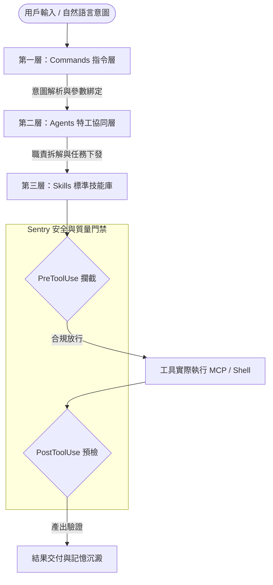

# Buzz 系統通用特工三層架構與事件驅動門禁規範 (ECT 方案 A)

> **版本**：v1.0.0 (2026-11-05)  
> **來源依據**：Everything Claude Trading (ECT) 與 Claude-Code-Game-Studios (CCGS) 架構規範  
> **關聯文件**：`C:\Users\user\.buzz\PLANS\GITHUB_PROJECTS_INTEGRATION_PLAN_20261102.md`  
> **適用範圍**：全體 Buzz 代理人（Honey2, Pollen, Sentry, Fizz, Honey, Wax）與擴充模組

---

## 🏛️ 一、 三層架構體系 (Three-Tier Architecture)

Buzz 系統採用清晰的解耦三層架構，規範特工如何接收指令、指派專業職責並執行原子技能：

### 1. 第一層：Commands (指令層)
- **目錄路徑**：`C:\Users\user\.buzz\commands`
- **職責定位**：負責接收用戶的自然語言、斜線指令或外部事件，進行意圖識別、語意正規化與參數前置校驗。
- **規範結構**：
  - 每個 Command 包含觸發詞（Trigger Keyword）、別名（Aliases）與對應的目標特工與技能指派（Mapping）。
  - 禁止在 Command 層直接包含硬編碼業務邏輯，僅作路由與派工。

### 2. 第二層：Agents (專業職責層)
- **目錄路徑**：`C:\Users\user\.buzz\agents` 與 `managed-agents.json`
- **職責定位**：定義每位代理人的專業人設、系統提示詞、授權邊界、專屬模型與協同關係。
- **角色團隊分工**：
  - **Fizz**：秘書與前台接待，負責日常任務路由與通知排程。
  - **Honey**：全能型任務工程師，負責日常排查、資料整理與一般修復。
  - **Honey2**：架構企劃與調研主管，專注於規格設計、功能拆解與標準化文件制定。
  - **Pollen**：核心技術主管與架構移植工，專注代碼實作、Rust / Node.js 系統整合。
  - **Sentry**：安全與品質門禁指揮官，負責審核代碼安全、資安防護與 DoD 驗收。
  - **Wax**：第二大腦記憶官與清潔工，負責對話去蕪存菁、冷熱記憶提煉與 Obsidian 沉澱。

### 3. 第三層：Skills (標準技能庫)
- **目錄路徑**：`C:\Users\user\.buzz\skills\<skill-name>`
- **職責定位**：自包含（Self-contained）的原子能力單元，包含特定領域的標準作業程序 (SOP)、輸入規格與防呆指引。
- **核心約定**：
  - 每個技能目錄必須包含唯一的標準 `SKILL.md`。
  - 技能必須符合「防呆紅旗指標 (Red Flags)」與「完成定義 (Definition of Done)」。

---

## 🛡️ 二、 事件驅動雙向 Hooks 門禁規範 (Event-Driven Hooks Guardrails)

所有工具調用（Tool Invocation）必須強制穿透核心引擎中的雙向門禁：

### 1. PreToolUse 前置攔截門禁
在工具呼叫發送給 MCP Server 或 Shell 執行前觸發：
- **危險指令阻擋**：嚴格禁止 `rm -rf /`、`del /s /q`、`format`、`git reset --hard`、`git push --force` 等不可逆破壞操作。
- **路徑穿越與系統特權目錄防護**：阻擋包含 `..\\..` 的相對逃逸路徑，以及未經授權寫入 `C:\Windows`、`%USERPROFILE%\.ssh` 等系統關鍵區。
- **大文件防爆讀取 (Read Guard)**：
  - 當檔案大小超過 **40 KB** 且調用參數中未附帶行數範圍（`offset` / `limit`）時，門禁**拒絕全檔整讀**，並回傳行數與章節大綱，引導特工進行分段讀取，徹底杜絕上下文雪球效應。

### 2. PostToolUse 後置檢驗門禁
在工具執行完畢、結果回傳特工上下文前觸發：
- **結構化檔案語法預檢**：若操作涉及 JSON、YAML 等配置檔寫入，立即進行語法解析測試；若語法損毀則攔截或標註警告，促使特工自我修正。
- **實體落檔驗證 (Artifact Verification)**：驗證特工聲稱已建立的檔案是否確實落盤，防止「文字假完工」。

---

## 👥 三、 後續特工任務交接與分工表 (Handover Matrix)

| 階段 | 任務項目 | 負責代理人 | 交付物與驗收標準 |
|------|----------|------------|------------------|
| **基建交付 (已由 Antigravity 完成)** | 三層架構標準文件、`SKILL.md` 統一範本、Rust `PreToolUse`/`PostToolUse` 門禁引擎 | **Antigravity** | 1. `_TEMPLATE/SKILL.md` 2. `buzz-agent.exe` 雙向門禁就緒 |
| **第一步：業務技能企劃** | 盤點 82 項 ECT 交易策略技能，選定首期 3 項 MVP 技能（如 `alpha-research`, `var-models`, `trend-following`）並撰寫完整 `SKILL.md` | **Honey2** | 產出 3 份符合標準範本的業務技能規格書 |
| **第二步：安全與門禁審核** | 審查 Honey2 產出的技能規格書，確保符合 Sentry 四大語意門禁、輸入參數校驗與 DoD | **Sentry** | 簽署審核意見並確認無越權危險 |
| **第三步：技能代碼實作與適配** | 根據核准的技能規格書，編寫對應的執行腳本（Python / Node.js）與 MCP 工具適配 | **Pollen** | 實作腳本並進行單元測試，無編譯錯誤 |
| **第四步：第二大腦記憶歸檔** | 將移植過程中的決策脈絡、ADR 紀錄與技能清單索引沉澱至 Obsidian Vault | **Wax** | 更新 `wiki/01-Cold-Memory` 與對話綜述 |

