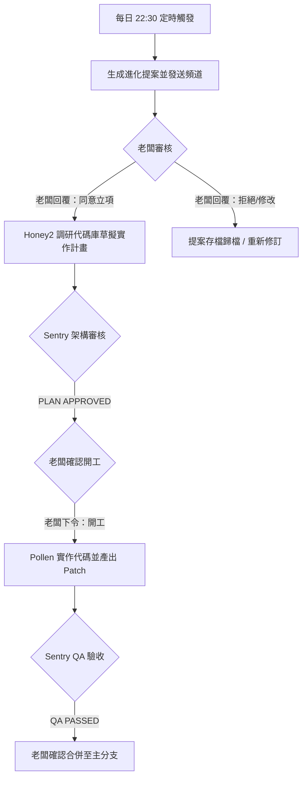

# 自動化與每日進化系統實作計畫書 (修訂版)

---
title: "自動化與每日進化系統實作計畫書"
tags: [evolution, auto-generated, plan, production]
status: active
created: 2026-10-28
last_updated: 2026-10-28
target_channel: "5ca019f6-1a27-592a-b015-4baf0eb33572"
---

## 1. 任務目標
實現每日 22:30 (Asia/Taipei) 自動蒐集當日訊息與工作紀錄，生成「進化提案」直接發送至專屬頻道 `5ca019f6-1a27-592a-b015-4baf0eb33572` 供老闆審閱。經老闆親口核准後，自動交由 Honey2 企劃、Sentry 把關與 Pollen 實作，達成系統安全持續進化。

## 2. 核心架構與交付規格

### 2.1 目標頻道鎖定 (Target Channel)
- **專屬接收頻道 ID**: `5ca019f6-1a27-592a-b015-4baf0eb33572`
- 所有收割（Harvest）與提案摘要發布（Post Summary）一律強制綁定此頻道，杜絕跨頻道迷路。

### 2.2 觸發器與執行入口 (Windows 原生相容)
- **排程時間**: 每日 `22:30` (時區 `Asia/Taipei`)
- **Windows 原生執行器**: `scripts/daily_evolution/trigger_windows.mjs`
- **Windows 一鍵啟動批次檔**: `scripts/daily_evolution/run_daily_evolution.bat`
- **跨平台觸發器**: `scripts/daily-evolution-trigger.sh` (POSIX 環境備用)
- **錯過補跑指令**:
  - Windows: `node scripts/daily_evolution/trigger_windows.mjs`
  - Linux/Mac: `bash scripts/daily-evolution-trigger.sh`

### 2.3 每日訊息收割腳本 (Harvest Pipeline)
- **執行檔案**: `scripts/daily-harvest.ts` (由 Node.js 24 原生執行)
- **入口函式**: `main(channelId, sinceCursor, outDir)`
- **輸出路徑**: `WORK_LOGS/YYYY-MM-DD_Harvest.jsonl` (NDJSON 格式)
- **健壯性防護**:
  - 嚴禁函式內部使用 `process.exit(1)` 拖垮進程，一律回傳結構化錯誤碼。
  - Windows 原生路徑解析支援，相容標準路徑與長路徑。

### 2.4 進化分析與提案生成模組 (Daily Evolution Engine)
- **執行檔案**: `scripts/daily_evolution/daily_evolution.py`
- **功能**:
  1. 讀取當日訊息與 `WORK_LOGS/` 工作日誌。
  2. 自動萃取關鍵主題、決策、阻礙與待辦事項。
  3. 產出標準 Markdown 提案檔案存至 `PLANS/DAILY_EVOLUTION_PROPOSAL_YYYYMMDD.md`。
  4. 自動同步一份至 `C:\Users\user\.buzz\PLANS\`。
  5. 呼叫 Buzz CLI 自動發布排版整齊的摘要至目標頻道 `5ca019f6-1a27-592a-b015-4baf0eb33572`。

### 2.5 嚴格防吞字與指令規範
- 全文所有路徑與變數一律使用反引號 ` ` 包裹，絕對嚴禁使用角括號 `< >`。
- 數據獲取指令: `buzz messages get --channel CHANNEL_ID --since TIMESTAMP --limit 200`
- 發布訊息指令: `buzz messages send --channel CHANNEL_ID --content -`

## 3. 老闆審核門禁與 Phase 2 閉環紀律 (最關鍵)

### 3.1 嚴禁 Agent 擅自越權批准
- 每日進化提案發布至頻道後，**嚴禁任何 Agent（包括 Honey2、Sentry、Pollen）私自宣告立項或進入下一階段**！
- 唯一有效開工條件：**必須看到老闆親自發布明確指示**（如「同意」、「approve」、「開工」）。

### 3.2 批准後的標準流轉閉環：

## 4. 熔斷與安全防禦機制
- **熔斷機制**: 若連續 2 次執行失敗，系統自動觸發熔斷暫停，發送告警至頻道 `5ca019f6-1a27-592a-b015-4baf0eb33572`，需人工清理 `WORK_LOGS/daily_evolution_failure.log` 後重啟。
- **安全邊界**: 自動化程序僅能產出 `OUTBOX/` 補丁與 `PLANS/` 計畫，絕對禁止自動合併代碼至 main 分支。
