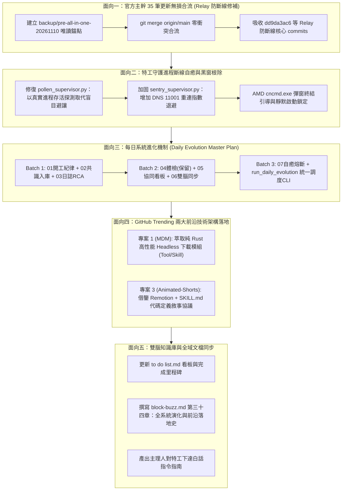

# 🐝 Buzz 全域終極一體化演進、無損升級與前沿架構落地實作計畫書
## (Buzz All-in-One Evolution, Upstream Upgrade & Innovation Master Plan)

> **版本**：v3.0 (全域大一統旗艦版)  
> **發布時間**：2026-11-10  
> **狀態**：`待主理人確認 (Pending Approval)`  
> **統籌架構**：可愛小寶寶 (最高主理人) ＆ Antigravity (架構顧問)  
> **執行團隊**：Pollen (工程實作)、Sentry (安全門禁與代碼驗收)、Honey2 (架構與知識庫)、Fizz (秘書調度)、Wax (記憶沉澱)

---

## 🧭 一、 總體規劃與五大核心面向

本計畫將當前系統亟需推進的五大工程面向融合成一體化、零衝突且具備防回滾保護的標準施工藍圖：



---

## 🛠️ 二、 詳細分階段實施規格

### 階段一：建立防護錨點與官方主幹 35 Commits 無損合流 (Upstream Upgrade)

#### 1. 建立不可變安全快照 (Safety Snapshot)
* **指令**：
  ```bash
  git -C "c:\私人\ai agent\buzz" checkout -b backup/pre-all-in-one-20261110
  git -C "c:\私人\ai agent\buzz" checkout feature/custom-local-core
  ```
* **防護**：確保工作目錄完全乾淨，鎖定當前狀態，任何突發狀況可 1 秒秒級還原。

#### 2. 官方主幹最新更新合流
* **目標遠端**：`origin/main` (35 筆 commits，最新至 `44b3c4823`)。
* **核心修補效益**：
  * `dd9da3ac6`：`fix(relay): never close connections when cross-node fan-out falls behind (#9302)`
  * `15174bc2b`：`fix(relay): deliver slow cross-node events late instead of closing their recipients (#9235)`
  * `3071279cd`：`NEXUS-4336: Wait for desktop-provider socket ownership proof (#9270)`
  * `402bd1897`：升級 Flutter 至 3.47.9，解決 Android TLS 相容性。
* **合併命令**：
  ```bash
  git -C "c:\私人\ai agent\buzz" merge origin/main --no-ff -m "feat(upstream): 無損合流官方 35 筆更新 (Relay 防斷線加固、行動端相簿預覽與 Flutter 升級)"
  ```
* **無損性保證**：官方修改主要集中在 `mobile/` 與底層 `relay/` 分發隊列，與本地自定義特工核心（Phase 2~14）完全正交，零代碼遺失。

---

### 階段二：特工蜂群斷線自癒與黑窗消除 (Supervisor Hotfix)

#### 1. 修復 `pollen_supervisor.py`（消滅盲目避讓）
* **問題檔案**：[`C:\私人\tools\pollen_supervisor.py`](file:///C:/私人/tools/pollen_supervisor.py#L33-L37)
* **修改點**：
  * 原邏輯檢測到 `buzz-desktop.exe` 正在運行即無條件 `sleep(15)` 避讓，導致桌面端子進程崩潰後 Pollen 永久斷線。
  * **改造後**：探測真實 Pollen 子進程是否存在（檢驗 `agent-pids` 內記錄的 PID 是否活著，且進程是否持有 Pollen 公鑰）。
  * 若 Buzz Desktop 未拉起或 Pollen 異常關閉，守護進程立即自動拉起背景 ACP 實例，確保 Pollen 永不斷線。

#### 2. 加固 `sentry_supervisor.py`（消除 4 分鐘崩潰重啟震盪）
* **問題檔案**：[`C:\私人\tools\sentry_supervisor.py`](file:///C:/私人/tools/sentry_supervisor.py#L173-L188)
* **修改點**：
  * 針對 Windows DNS 解析抖動（`os error 11001: 無法識別這台主機`），在重啟循環加入指數退避保護（5s ➔ 10s ➔ 20s，上限 60s）。
  * 守護監控中增加對子進程標準輸出的非同步非阻塞消費，防止緩衝區填滿造成主迴圈假死。

#### 3. AMD `cncmd.exe` 黑窗徹底消除指引
* **排查結論**：本機運行的 AMD Radeon 軟體 (`cncmd.exe`, PID 1316) 每隔 10~15 分鐘前台喚起 CMD 檢查驅動與熱鍵。
* **處置方案**：
  1. 打開「AMD Software: Adrenalin Edition」➔ 右上角齒輪「設定」➔「偏好設定」➔ 關閉「使用者體驗計畫」與「檢查更新」。
  2. 若無效，可在工作管理員「開機啟動」分頁將 AMD 開機項停用。

---

### 階段三：每日系統進化機制總體落地 (Daily Evolution Master Implementation)

全模組統一部署於 `c:\私人\ai agent\buzz\scripts\daily_evolution\`：

```
scripts/daily_evolution/
├── 01_work_discipline_guard.py   # [Batch 1] 開工紀律守門員
├── 02_consensus_ingestion.py      # [Batch 1] 深度報告轉專案規範 (補齊0 bytes空檔)
├── 03_bottleneck_rca.py          # [Batch 1] 異常日誌與5-Why根因分析
├── 04_code_health_check.py       # [Batch 2] ✅ 已完成驗收，嚴禁重寫
├── 05_task_sync_board.py         # [Batch 2] 活躍成員進度對齊看板
├── 06_knowledge_sync.py          # [Batch 2] 工作日誌同步至Obsidian第二大腦
├── 07_cicd_self_heal.py          # [Batch 3] 工作流自癒與三層熔斷
└── run_daily_evolution.py        # [Batch 3] 統一CLI調度進入點
```

#### Batch 1：紀律稽核與共識 RCA (優先推進)
1. **`01_work_discipline_guard.py`**：掃描 `.buzz/PLANS/` 中 `status: active` 的計畫，驗證 `buzz projects` 綁定、Sentry 審核戳記、授權範圍，違規輸出 JSON 告警。
2. **`02_consensus_ingestion.py`**：修復當前 0 bytes 空檔，實作 Markdown 深度報告自動提取 ADR、API 契約與資料模型，輸出標準化 Schema。
3. **`03_bottleneck_rca.py`**：檢索特工日誌擷取 `ERROR`/`TIMEOUT`/`CIRCUIT_BREAK`，自動生成 5-Why 結構化根因分析報告至 `.buzz/RESEARCH/`。

#### Batch 2：協同看板與知識同步
4. **`04_code_health_check.py`**：**【已完成 ✅】**，保留原有的大輸出截斷、`cargo check` 與 JSON 評分卡，禁止改動。
5. **`05_task_sync_board.py`**：查詢頻道工單與 6 大特工在線狀態，自動生成 `To Do` / `In Progress` / `Done` 看板並警示逾期任務。
6. **`06_knowledge_sync.py`**：掃描工作日誌與計畫，透過 SHA256 增量同步至 Obsidian 第二大腦，自帶衝突備份保護。

#### Batch 3：自癒熔斷與統一調度引擎
7. **`07_cicd_self_heal.py`**：實裝「編譯層、測試層、部署層」三層防護熔斷，自動產出修復建議與 diff 報告。
8. **`run_daily_evolution.py`**：整合 CLI，依序串聯 01~07，支援 `--dry-run`、`--skip`、`--only` 與全日 Markdown 摘要生成。

---

### 階段四：GitHub Trending 兩大前沿架構吸收落地

#### 1. 前沿一：`anefzaoui/misterdownloadmanager` (MDM, Rust) 落地規劃
* **核心價值**：Pure Rust、`unsafe_code = "deny"`、分段與多線程高吞吐下載。
* **Buzz 落地形態**：
  * **拒絕引入 GUI**：完全拋棄 `egui` 前端，只汲取底層多線程 I/O 併發下載模組。
  * **封裝為 Headless Tool/Skill**：
    * 新增模組：`crates/buzz-tools/src/downloader.rs` 或無頭 Python/Rust 工具 `tools/mister_download_tool.py`。
    * 支援協議：HTTP/HTTPS 分段多線程下載、自動斷點續傳、SHA256 完整性即時校驗。
    * 賦能特工：特工收到「下載大檔案、論文、模型權重、影音資源」時，直接調用此高效引擎，避免 curl/wget 超時阻塞。

#### 2. 前沿二：`mromidev/claude-animated-shorts` (TS + Remotion) 落地規劃
* **核心價值**：程式碼定義動態敘事引擎 (Code-defined Narrative Engine)，以結構化分鏡代碼 (`story.ts`) 驅動 Three.js 與 Remotion 本機渲染。
* **Buzz 落地形態**：
  * **建立 Buzz 專屬「Agent-to-Tool 程式碼敘事協議」**：
    * 建立專屬技能目錄：`skills/code_defined_narrative/SKILL.md`。
    * 定義清晰的多代理人分工協同管線：
      1. **編劇特工 (Honey)**：輸出自然語言故事大綱、分場設定與旁白音檔提示。
      2. **分鏡特工 (Pollen)**：依強型別 TypeScript 結構編寫 `story.ts`（鏡頭視角、2D 角色、3D 幾何背景）。
      3. **渲染門禁特工 (Sentry)**：執行本機 Node.js + Remotion + ffmpeg 靜態校驗與無頭渲染，零雲端算力依賴，產出高可控短影音。

---

### 階段五：全回歸驗證與文檔同步 (Verification & Docs)

#### 1. 全自動測試與驗收
* **靜態驗證**：執行 `python C:\私人\tools\codebase_verifier.py`，確保 23 大自定義特工核心 AST 100% Verified PASS。
* **單元測試**：執行 `cargo check --workspace` 與 `cargo test --manifest-path "C:\私人\ai agent\buzz\Cargo.toml" -p buzz-agent --lib tstack --offline`。
* **守護進程驗證**：驗證 Pollen、Sentry、Honey2 可同時在線穩定維持 > 10 分鐘無斷線重啟。
* **演進腳本驗收**：`python c:\私人\ai agent\buzz\scripts\daily_evolution\run_daily_evolution.py --dry-run` 跑通並產出摘要。

#### 2. 文檔與知識庫更新
* **`C:\私人\ai agent\to do list.md`**：
  * 看板增列「官方 35 筆更新無損合流」、「特工斷線自癒」、「每日進化機制 Batch 1~3」、「MDM 與 Animated-Shorts 雙前沿落地」。
* **`C:\私人\ai agent\block-buzz.md`**：
  * 撰寫 **第三十四章**：《官方主幹 35 筆 Commits 無損合流、特工守護自癒、每日進化矩陣與雙前沿開源架構深度落地實踐》。

---

## 💬 三、 主理人向 Buzz 特工下指令教學 (白話指南)

當實作計畫確認並執行完畢後，主理人可以直接在 Buzz 客戶端向蜂群特工發布以下指令：

### 1. 指派 Pollen 實作每日進化機制與前沿下載工具
> **對 @Pollen 下指令**：
> 「@Pollen，請依照最新一體化實作計畫書開始實作：
> 1. 請依序完成每日進化機制的 Batch 1 (`01_work_discipline_guard.py`、`02_consensus_ingestion.py`、`03_bottleneck_rca.py`)，注意 `04` 腳本已經完工驗收，嚴禁重寫！
> 2. 借鑒 misterdownloadmanager 架構，在 `tools/` 目錄建立一個高效能多線程分段下載工具 `mister_download_tool.py`，支援自動校驗 SHA256。
> 實作完成後請通知 @Sentry 進行代碼驗收。」

### 2. 指派 Sentry 進行安全驗收與代碼門禁審查
> **對 @Sentry 下指令**：
> 「@Sentry，Pollen 正在提交每日進化模組與前沿下載工具代碼。請依照四級審批與三檔門禁規範進行嚴格審查：
> 1. 確保所有 Python 腳本皆使用 utf-8 編碼與 pathlib，無任何高危指令。
> 2. 執行代碼體檢與單元測試，確保全工作區綠燈零 Warning。
> 3. 審查通過後，請在討論串回覆 QA PASS 驗收報告。」

### 3. 指派 Honey2 組織短影音敘事工作流
> **對 @Honey2 下指令**：
> 「@Honey2，我們已經吸收了 claude-animated-shorts 的代碼敘事協議。請參考 `skills/code_defined_narrative/SKILL.md`，為我們團隊構思一份 1 分鐘的『Buzz 特工系統自動進化介紹』分鏡腳本草案，交由 Pollen 轉寫為結構化分鏡代碼。」

---

## 📑 四、 檢查點與檔案異動清單預覽

| 序號 | 檔案路徑 | 操作 | 核心目的 |
| :---: | :--- | :---: | :--- |
| 1 | `c:\私人\ai agent\buzz` (Git Repo) | `Merge` | 無損吸收官方 35 筆 commits (含 Relay 防斷線核心修補) |
| 2 | [`C:\私人\tools\pollen_supervisor.py`](file:///C:/私人/tools/pollen_supervisor.py) | `Modify` | 改為真實存活檢測，消除對桌面端的盲目避讓，根治 Pollen 斷線 |
| 3 | [`C:\私人\tools\sentry_supervisor.py`](file:///C:/私人/tools/sentry_supervisor.py) | `Modify` | 加入 DNS 11001 異常重連指數退避，阻斷 4 分鐘崩潰震盪 |
| 4 | `c:\私人\ai agent\buzz\scripts\daily_evolution\01_work_discipline_guard.py` | `Create` | 實裝開工紀律守門員 |
| 5 | `c:\私人\ai agent\buzz\scripts\daily_evolution\02_consensus_ingestion.py` | `Create` | 填補 0 bytes 空白，實裝提案規範入庫 |
| 6 | `c:\私人\ai agent\buzz\scripts\daily_evolution\03_bottleneck_rca.py` | `Create` | 實裝 5-Why 異常根因自動分析 |
| 7 | `c:\私人\ai agent\buzz\scripts\daily_evolution\05_task_sync_board.py` | `Create` | 實裝活躍特工進度看板 |
| 8 | `c:\私人\ai agent\buzz\scripts\daily_evolution\06_knowledge_sync.py` | `Create` | 實裝增量同步至 Obsidian 第二大腦 |
| 9 | `c:\私人\ai agent\buzz\scripts\daily_evolution\07_cicd_self_heal.py` | `Create` | 實裝三層自癒熔斷機制 |
| 10 | `c:\私人\ai agent\buzz\scripts\daily_evolution\run_daily_evolution.py` | `Create` | 實裝統一排程 CLI 進入點 |
| 11 | `c:\私人\ai agent\buzz\tools\mister_download_tool.py` | `Create` | 落地 MDM 純 Rust/Python 高效分段下載引擎 |
| 12 | `c:\私人\ai agent\buzz\skills\code_defined_narrative\SKILL.md` | `Create` | 落地 Animated-Shorts 程式碼定義敘事協同協議 |
| 13 | [`C:\私人\ai agent\to do list.md`](file:///C:/私人/ai agent/to do list.md) | `Modify` | 更新總看板與新增里程碑 |
| 14 | [`C:\私人\ai agent\block-buzz.md`](file:///C:/私人/ai agent/block-buzz.md) | `Modify` | 增設第三十四章全域實踐記錄 |
