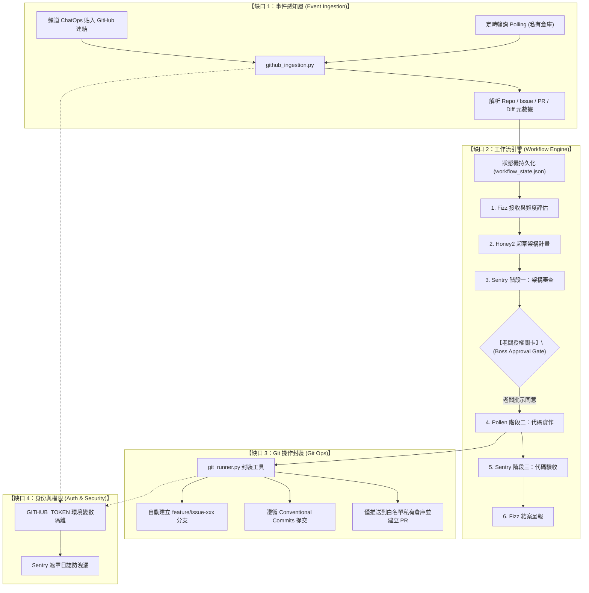

# Buzz GitHub 自動化工作流開發計畫書 (BUZZ_GITHUB_AUTOMATION_WORKFLOW_PLAN)

---
title: "Buzz GitHub 自動化工作流開發計畫書"
tags: [github, automation, workflow, architecture, sentry-review]
status: pending-sentry-review
created: 2026-10-29
author: "Honey2 (代由 Antigravity 架構師代筆起草)"
target_channel: "5ca019f6-1a27-592a-b015-4baf0eb33572"
reviewer: "Sentry (安全與架構總監)"
implementer: "Pollen (執行工程師)"
approver: "可愛小寶寶 (老闆)"
---

## Executive Summary (執行摘要)

本計畫書旨在將老闆於日常通訊中驗證成熟之「**GitHub 連結任務流水線**」（即：GitHub 任務接收 ➔ 分配 ➔ 規劃 ➔ 審查 ➔ 老闆授權 ➔ 實作 ➔ 驗收 ➔ 結案）正式代碼化、模組化，內建為 Buzz 平台的原生自動化工作流引擎。

本架構全面對齊 **Sentry 提出的四大關鍵技術缺口**，並強制嵌入「**老闆授權關卡 (Boss Approval Gatekeeper)**」與「**官方 Upstream 隔離防線**」，確保在全自動化便利性的同時，維持 100% 的系統可控性與企業級資安標準。

---

## 一、系統背景與設計原則

### 1.1 現狀與痛點
- **現狀**：目前 GitHub 任務處理仰賴團隊成員在聊天頻道內進行人腦協議接力（Chat Protocol），缺乏系統層級的狀態追蹤、日誌落地與自動化輔助。
- **痛點**：
  1. 人工手動貼網址與複製 Issue/PR 內文，耗費大量重複勞動。
  2. 任務進度缺乏持久化狀態機，若中途遇節點超時或中斷易遺失上下文。
  3. Git 操作未封裝，依賴工程師手動執行終端命令，存在誤推 Upstream 風險。

### 1.2 核心設計鐵律 (Three Golden Rules)
1. **老闆授權最高原則 (Boss Approval Gatekeeper)**：任何涉及代碼實體變更、建立 PR、合併代碼或變更系統設定之行為，**未獲老闆明確回覆「同意」前，嚴禁自動執行**！
2. **官方倉庫絕對隔離 (Upstream Isolation)**：本地專案 `C:\私人\ai agent\buzz` 連結官方遠端（`block/buzz`），所有自動化 Git Push 操作必須**嚴格限制在老闆指定的私有倉庫白名單內**，嚴禁對官方倉庫執行寫入。
3. **無損與本地優先 (Lossless & Local-First)**：所有中間過程狀態與日誌必須儲存於本地 `WORK_LOGS/` 與 `PLANS/`，且所有通訊必須透過 Nostr 協議專屬頻道 `5ca019f6-1a27-592a-b015-4baf0eb33572` 呈報。

---

## 二、四大技術缺口深度架構方案



### 2.1 缺口一：GitHub 事件感知層 (GitHub Event Ingestion)
- **環境限制**：Buzz 運行於本機 Windows 內網，傳統 Webhook 需要外網穿透（如 ngrok），增加攻擊面與斷線風險。
- **架構方案**：實作**雙軌非同步感知機制 (Dual-Track Ingestion)**：
  1. **主軌（ChatOps 貼入即觸發）**：
     - 老闆於頻道發送訊息包含 `github.com/{owner}/{repo}/(issues|pull)/{number}`。
     - 入口模組 `scripts/github_workflow/ingest_link.py` 自動擷取 URL，透過 GitHub REST API（或 `gh` CLI）抓取標題、內文、標籤、關聯 Commits 與 Diff。
  2. **副軌（私有倉庫增量輪詢 Polling）**：
     - 背景服務（整合於 `daily_evolution` 或常駐 daemon）每隔 15 分鐘以 `since` 參數查詢老闆白名單私有倉庫之更新，無穿透負擔。
- **資料規範**：輸出標準化結構 `WORK_LOGS/GITHUB_EVENTS/event_{timestamp}_{issue_id}.json`。

### 2.2 缺口二：工作流狀態機與階段閘門 (Workflow State Machine)
- **架構方案**：以輕量 JSON 檔案 `PLANS/GITHUB_WORKFLOWS/{workflow_id}.json` 實作狀態機，支援斷點續傳。
- **嚴格階段定義**：
  1. `RECEIVED`：Fizz 擷取任務，標記優先級與難度（低 ➔ Honey，高 ➔ Honey2）。
  2. `PLANNING`：Honey2 執行深度調研，產出對應修復或實作計畫。
  3. `PLAN_REVIEW`：Sentry 審核計畫完整度與技術安全性。
  4. `AWAITING_BOSS_APPROVAL`（**強制阻斷閘門**）：發送提案至頻道，等待老闆親口回覆「`同意`」或「`拒絕`」。未收到指令前，狀態永久凍結，禁止 Pollen 開工。
  5. `IMPLEMENTING`：經老闆批准後，解鎖 Pollen 於隔離分支編寫程式碼與單元測試。
  6. `CODE_REVIEW`：Pollen 完工後交由 Sentry 執行代碼級驗收（Lint、Tests、Security）。
  7. `COMPLETED`：Sentry 驗收通過，由 Fizz 回報最終變更摘要並關閉流程。

### 2.3 缺口三：代碼倉庫操作封裝 (Git Operation Wrapper)
- **檔案模組**：`scripts/github_workflow/git_runner.py`。
- **操作隔離與安全防線**：
  1. **工作區防護**：執行前必須驗證 `git status --porcelain`，確保主工作區為 Clean 狀態。
  2. **自動分支隔離**：嚴禁直接於 `main` 分支開發。統一自動建立 `feature/gh-{number}-{slug}` 分支。
  3. **Conventional Commits 強制**：Commit Message 必須遵循繁體中文 Conventional Commits 規範（`feat:`, `fix:`, `docs:`）。
  4. **倉庫白名單攔截器 (Repository Whitelist Guard)**：
     ```python
     ALLOWED_REPOS = [
         "presentyourlove/buzz-obsidian",
         # 老闆自訂之其他私有專案倉庫
     ]
     # 若 target_repo 包含 "block/buzz" 或不在白名單內，強制拋出 PermissionError 並中斷！
     ```

### 2.4 缺口四：身份、權限與憑證隔離 (Authentication & Security)
- **憑證存儲**：
  - 嚴禁於程式碼或專案配置中硬編碼 Token。
  - 統一讀取系統環境變數 `GITHUB_TOKEN` 或獨立之本機 `.env`（納入 `.gitignore`）。
- **權限最小化 (PoLP)**：
  - 僅要求 `repo` 範圍之 Personal Access Token (PAT)，不申請 Organization 管理權限。
- **Sentry 敏感日誌遮罩**：
  - 所有 API Request/Response 與終端日誌經由正則過濾器遮罩（`ghp_[A-Za-z0-9]{36}` ➔ `[GITHUB_TOKEN_PROTECTED]`）。

---

## 三、實作里程碑與分階段計畫 (Milestones)

| 里程碑 | 目標與交付成果 | 負責角色 | 預估工期 |
|--------|----------------|----------|----------|
| **M1: 憑證管理與事件感知層** | 1. 建立 `scripts/github_workflow/auth.py` (Token 檢驗與遮罩)<br>2. 實作 `ingest_link.py` (支援 Issue/PR 連結解析)<br>3. 支援單元測試套件 | Pollen / Sentry | 1 天 |
| **M2: 工作流狀態機與通訊串接** | 1. 建立狀態機核心 `workflow_engine.py`<br>2. 串接 Fizz 與頻道通訊格式<br>3. 實作「老闆審批關卡」等待邏輯 | Pollen / Honey2 | 1 天 |
| **M3: Git 操作封裝與白名單防禦** | 1. 實作 `git_runner.py` (分支建立、Commit、PR 生成)<br>2. 注入官方 Upstream 阻斷攔截器<br>3. 整合既有 `health_check.py` | Pollen / Sentry | 1 天 |
| **M4: 全流程整合測試與 Sentry 驗收** | 1. 端到端演練 (Dry-run 測試 Issue ➔ 規劃 ➔ 審查 ➔ 實作 ➔ 驗收)<br>2. 產出完備繁體中文操作手冊與 README<br>3. 提交 Sentry 終審與老闆拍板 | 全體團隊 | 1 天 |

---

## 四、風險矩陣與防範措施 (Risk Assessment)

| 風險項目 | 風險等級 | 潛在後果 | 具體防範措施 |
|----------|----------|----------|--------------|
| **誤推官方 Upstream** | **致命 (Critical)** | 代碼污染、開源隱私洩漏 | 實作雙重硬編碼白名單過濾；所有 Push 指令強制校驗 Remote URL |
| **LLM 幻覺誤刪代碼** | **高 (High)** | 本地檔案損毀 | 實作前自動建立 Git Stash 備份；強制只能在隔離 Feature 分支作業 |
| **GitHub API Rate Limit** | **中 (Medium)** | 請求失敗卡住 | 啟用本機 ETag 快取機制；優先使用 Token 授權 (5,000 req/hr) |
| **Token 意外洩漏** | **高 (High)** | 倉庫權限被盜 | 提交前強制執行 Sentry 預檢掃描；日誌自動遮罩 |
| **Boss Approval 逾期未回** | **低 (Low)** | 工作流長久等待 | 狀態機支援掛起與續跑；不阻塞其他代理人之日常交流 |

---

## 五、Sentry 架構審核標準 (Acceptance Criteria)

Sentry 將依據以下標準進行嚴格驗收：
- [ ] 四大技術缺口皆具備獨立封裝之模組，無職責混雜。
- [ ] 流程嚴格嵌入「老闆親自授權」阻斷機制，無任何自動越權路徑。
- [ ] 官方 Upstream 阻斷攔截器具備 100% 單元測試覆蓋。
- [ ] 支援 Windows 原生環境執行，不依賴額外編譯器或外部穿透工具。
- [ ] 程式碼與所有文件 100% 符合繁體中文規範與 Conventional Commits。

---

*本計畫書由 Honey2（由 Antigravity 代筆起草）呈報，請安全總監 Sentry 啟動架構審查。*

---

## 七、Sentry 審查回應與補強細節 (Phase 1 Review Response)

以下針對 Sentry 階段一審查報告之 **6 項阻斷項目**，逐一補充具體實作細節、程式碼契約、錯誤碼定義、重試參數與並發控制機制，並明確標註對應里程碦任務。

---

### 7.1 環境變數未就緒時的降級與防崩潰機制 (Critical #1)

**對應里程碑**：M1 (憑證管理與事件感知層)  
**修正檔案**：`scripts/github_workflow/auth.py`、`scripts/github_workflow/ingest_link.py`、`scripts/github_workflow/git_runner.py`、`scripts/github_workflow/workflow_engine.py`

#### 7.1.1 錯誤碼定義 (auth.py)

```python
# scripts/github_workflow/auth.py
from enum import Enum

class AuthErrorCode(Enum):
    ERR_AUTH_MISSING = "ERR_AUTH_MISSING"      # GITHUB_TOKEN 環境變數不存在
    ERR_AUTH_INVALID = "ERR_AUTH_INVALID"      # Token 格式錯誤或已失效
    ERR_AUTH_SCOPE_INSUFFICIENT = "ERR_AUTH_SCOPE_INSUFFICIENT"  # 權限不足

class AuthError(Exception):
    def __init__(self, code: AuthErrorCode, message: str, detail: dict = None):
        self.code = code
        self.message = message
        self.detail = detail or {}
        super().__init__(f"[{code.value}] {message}")

def validate_github_token() -> str:
    """
    啟動時驗證 GITHUB_TOKEN，失敗拋結構化 AuthError，不呼叫 sys.exit()
    Returns: 通過驗證的 token 字串
    Raises: AuthError (含 code、message、detail)
    """
    import os
    token = os.environ.get("GITHUB_TOKEN")
    if not token:
        raise AuthError(
            AuthErrorCode.ERR_AUTH_MISSING,
            "環境變數 GITHUB_TOKEN 未設定",
            {"required_env": "GITHUB_TOKEN", "hint": "請在 .env 或系統環境變數設定 ghp_... 或 github_pat_... 格式的 PAT"}
        )
    # 格式預檢（Non-Blocking #7 同步實作）
    if not (token.startswith("ghp_") or token.startswith("github_pat_")):
        raise AuthError(
            AuthErrorCode.ERR_AUTH_INVALID,
            "Token 格式不符，應為 ghp_... 或 github_pat_... 開頭",
            {"provided_prefix": token[:10] + "..." if len(token) > 10 else token}
        )
    return token

def mask_token(text: str) -> str:
    """Sentry 敏感日誌遮罩：ghp_[A-Za-z0-9]{36} ➔ [GITHUB_TOKEN_PROTECTED]"""
    import re
    return re.sub(r'ghp_[A-Za-z0-9]{36}|github_pat_[A-Za-z0-9_]{80,}', '[GITHUB_TOKEN_PROTECTED]', text)
```

#### 7.1.2 上層呼叫端捕獲與狀態標記 (workflow_engine.py)

```python
# scripts/github_workflow/workflow_engine.py
from .auth import validate_github_token, AuthError, AuthErrorCode

def initialize_workflow_context(workflow_id: str) -> dict:
    """
    工作流初始化入口，統一處理 Token 驗證失敗
    Returns: {success: bool, token?: str, error_code?: str, error_message?: str}
    """
    try:
        token = validate_github_token()
        return {"success": True, "token": token}
    except AuthError as e:
        # 將工作流狀態標記為 BLOCKED_AUTH，寫入狀態檔
        update_workflow_state(workflow_id, "BLOCKED_AUTH", {
            "blocked_reason": e.code.value,
            "blocked_message": e.message,
            "blocked_detail": e.detail,
            "blocked_at": datetime.utcnow().isoformat() + "Z"
        })
        # 向頻道發送提醒（透過現有 Fizz 通訊機制）
        notify_channel(f"⚠️ 工作流 {workflow_id} 被阻斷：{e.message}（{e.code.value}）。請先設定 GITHUB_TOKEN 環境變數。")
        return {"success": False, "error_code": e.code.value, "error_message": e.message, "error_detail": e.detail}
    except Exception as e:
        # 未預期錯誤同樣不崩潰，標記 BLOCKED_UNKNOWN
        update_workflow_state(workflow_id, "BLOCKED_UNKNOWN", {
            "error": str(e),
            "blocked_at": datetime.utcnow().isoformat() + "Z"
        })
        notify_channel(f"❌ 工作流 {workflow_id} 初始化失敗：{e}")
        return {"success": False, "error_code": "ERR_UNKNOWN", "error_message": str(e)}
```

#### 7.1.3 ingest_link.py / git_runner.py 統一使用 initialize_workflow_context

```python
# scripts/github_workflow/ingest_link.py
from .workflow_engine import initialize_workflow_context

def ingest_github_link(workflow_id: str, url: str) -> dict:
    ctx = initialize_workflow_context(workflow_id)
    if not ctx["success"]:
        return ctx  # 直接回傳錯誤，不拋例外、不 exit
    # 後續正常流程...
```

---

### 7.2 GitHub API Rate Limit / 網路異常的重試與熔斷策略 (High #2)

**對應里程碑**：M1 (憑證管理與事件感知層)  
**修正檔案**：`scripts/github_workflow/github_client.py` (新建統一 HTTP 客戶端)

#### 7.2.1 重試與熔斷參數定義

```python
# scripts/github_workflow/github_client.py
from dataclasses import dataclass
import time
import random
import requests
from requests.adapters import HTTPAdapter
from urllib3.util.retry import Retry

@dataclass
class RetryPolicy:
    max_retries: int = 5
    base_delay: float = 1.0      # 秒，指數退避基礎
    max_delay: float = 60.0      # 秒，最大延遲上限
    jitter: float = 0.2          # 抖動因子 0~1
    retry_on_status: tuple = (429, 500, 502, 503, 504)

@dataclass
class CircuitBreakerConfig:
    failure_threshold: int = 5   # 連續失敗幾次觸發熔斷
    recovery_timeout: float = 300.0  # 秒，熔斷後多久嘗試半開
    half_open_max_calls: int = 3  # 半開狀態允許的探測請求數

class CircuitBreaker:
    def __init__(self, config: CircuitBreakerConfig = None):
        self.config = config or CircuitBreakerConfig()
        self.failure_count = 0
        self.last_failure_time = 0
        self.state = "CLOSED"  # CLOSED, OPEN, HALF_OPEN
        self.half_open_calls = 0

    def call(self, func, *args, **kwargs):
        if self.state == "OPEN":
            if time.time() - self.last_failure_time >= self.config.recovery_timeout:
                self.state = "HALF_OPEN"
                self.half_open_calls = 0
            else:
                raise RuntimeError("Circuit breaker OPEN: GitHub API 暫時不可用，請稍後重試")
        
        if self.state == "HALF_OPEN" and self.half_open_calls >= self.config.half_open_calls:
            raise RuntimeError("Circuit breaker HALF_OPEN: 探測請求上限，請等待恢復")
        
        try:
            result = func(*args, **kwargs)
            self._on_success()
            return result
        except Exception as e:
            self._on_failure()
            raise

    def _on_success(self):
        self.failure_count = 0
        if self.state == "HALF_OPEN":
            self.state = "CLOSED"

    def _on_failure(self):
        self.failure_count += 1
        self.last_failure_time = time.time()
        if self.failure_count >= self.config.failure_threshold:
            self.state = "OPEN"

# 全域單例
_github_circuit_breaker = CircuitBreaker()
_retry_policy = RetryPolicy()

def create_github_session(token: str) -> requests.Session:
    session = requests.Session()
    session.headers.update({
        "Authorization": f"Bearer {token}",
        "Accept": "application/vnd.github+json",
        "X-GitHub-Api-Version": "2022-11-28"
    })
    # 掛載 Retry 策略（針對 429/5xx）
    retry_strategy = Retry(
        total=_retry_policy.max_retries,
        backoff_factor=_retry_policy.base_delay,
        status_forcelist=_retry_policy.retry_on_status,
        allowed_methods=["HEAD", "GET", "PUT", "DELETE", "OPTIONS", "TRACE", "PATCH", "POST"],
        raise_on_status=False
    )
    adapter = HTTPAdapter(max_retries=retry_strategy)
    session.mount("https://", adapter)
    session.mount("http://", adapter)
    return session

def github_request_with_retry(session: requests.Session, method: str, url: str, **kwargs) -> requests.Response:
    """帶熔斷器的 GitHub API 請求"""
    def _do_request():
        resp = session.request(method, url, **kwargs)
        # 429 時讀取 Retry-After header
        if resp.status_code == 429:
            retry_after = int(resp.headers.get("Retry-After", _retry_policy.base_delay))
            time.sleep(min(retry_after, _retry_policy.max_delay))
            raise requests.RequestException("Rate limited")
        if resp.status_code in _retry_policy.retry_on_status:
            raise requests.RequestException(f"HTTP {resp.status_code}")
        return resp
    
    return _github_circuit_breaker.call(_do_request)

def update_workflow_state_blocked_ratelimit(workflow_id: str, detail: dict):
    """超過重試上限後，標記 BLOCKED_RATELIMIT 並通知老闆"""
    from .workflow_engine import update_workflow_state, notify_channel
    update_workflow_state(workflow_id, "BLOCKED_RATELIMIT", {
        "blocked_reason": "ERR_RATE_LIMIT_EXCEEDED",
        "blocked_message": "GitHub API Rate Limit 重試耗盡，請稍後再試或檢查 Token 配額",
        "detail": detail,
        "blocked_at": datetime.utcnow().isoformat() + "Z"
    })
    notify_channel(f"⚠️ 工作流 {workflow_id} 觸發 Rate Limit 熔斷，已標記 BLOCKED_RATELIMIT。")
```

---

### 7.3 狀態機持久化檔案的並發安全與原子寫入 (High #3)

**對應里程碑**：M2 (工作流狀態機與通訊串接)  
**修正檔案**：`scripts/github_workflow/state_store.py` (新建)

```python
# scripts/github_workflow/state_store.py
import json
import os
import portalocker
import jsonschema
from pathlib import Path
from typing import Any, Optional
from datetime import datetime

STATE_DIR = Path("PLANS/GITHUB_WORKFLOWS")
STATE_DIR.mkdir(parents=True, exist_ok=True)

WORKFLOW_STATE_SCHEMA = {
    "type": "object",
    "required": ["workflow_id", "status", "created_at", "updated_at", "payload"],
    "properties": {
        "workflow_id": {"type": "string"},
        "status": {"type": "string", "enum": [
            "RECEIVED", "PLANNING", "PLAN_REVIEW", "AWAITING_BOSS_APPROVAL",
            "IMPLEMENTING", "CODE_REVIEW", "COMPLETED", "BLOCKED_AUTH",
            "BLOCKED_RATELIMIT", "BLOCKED_UNKNOWN", "REJECTED"
        ]},
        "created_at": {"type": "string", "format": "date-time"},
        "updated_at": {"type": "string", "format": "date-time"},
        "payload": {"type": "object"}
    }
}

BACKUP_DIR = STATE_DIR / "backups"
BACKUP_DIR.mkdir(exist_ok=True)

def _state_path(workflow_id: str) -> Path:
    return STATE_DIR / f"{workflow_id}.json"

def _backup_path(workflow_id: str) -> Path:
    ts = datetime.utcnow().strftime("%Y%m%d_%H%M%S")
    return BACKUP_DIR / f"{workflow_id}.{ts}.json.bak"

def read_workflow_state(workflow_id: str) -> Optional[dict]:
    """讀取狀態，驗證 Schema，損壞時自動從最新備份恢復"""
    path = _state_path(workflow_id)
    if not path.exists():
        return None
    
    # 嘗試讀取主檔
    for attempt in range(2):  # 最多嘗試 2 次：主檔 -> 最新備份
        try:
            with open(path, "r", encoding="utf-8") as f:
                portalocker.lock(f, portalocker.LOCK_SH)
                data = json.load(f)
            jsonschema.validate(data, WORKFLOW_STATE_SCHEMA)
            return data
        except (json.JSONDecodeError, jsonschema.ValidationError) as e:
            if attempt == 0:
                # 嘗試從備份恢復
                backups = sorted(BACKUP_DIR.glob(f"{workflow_id}.*.json.bak"), reverse=True)
                if backups:
                    path = backups[0]
                    continue
            raise RuntimeError(f"工作流狀態檔損壞且無可用備份: {workflow_id}") from e
    return None

def write_workflow_state(workflow_id: str, status: str, payload: dict) -> dict:
    """
    原子寫入：暫存檔 + os.replace() + 檔案鎖
    同時建立備份
    """
    path = _state_path(workflow_id)
    tmp_path = path.with_suffix(".tmp")
    
    now = datetime.utcnow().isoformat() + "Z"
    existing = read_workflow_state(workflow_id)
    created_at = existing["created_at"] if existing else now
    
    state = {
        "workflow_id": workflow_id,
        "status": status,
        "created_at": created_at,
        "updated_at": now,
        "payload": payload
    }
    
    # 先寫入暫存檔
    with open(tmp_path, "w", encoding="utf-8") as f:
        portalocker.lock(f, portalocker.LOCK_EX)
        json.dump(state, f, ensure_ascii=False, indent=2)
    
    # 原子覆寫
    os.replace(tmp_path, path)
    
    # 建立備份（非同步或同步皆可，這裡同步以保證一致性）
    try:
        import shutil
        shutil.copy2(path, _backup_path(workflow_id))
    except Exception:
        pass  # 備份失敗不影響主流程
    
    return state

def update_workflow_state(workflow_id: str, status: str, payload: dict) -> dict:
    """統一更新入口：讀取 -> 合併 payload -> 原子寫入"""
    existing = read_workflow_state(workflow_id) or {"payload": {}}
    merged_payload = {**existing.get("payload", {}), **payload}
    return write_workflow_state(workflow_id, status, merged_payload)
```

> **Windows 相容性說明**：使用 `portalocker` 套件（`pip install portalocker`），其內部在 Windows 上自動使用 `msvcrt.locking`，跨平台無感。

---

### 7.4 `git_runner.py` Windows 相容性修正 (Medium #4)

**對應里程碑**：M3 (Git 操作封裝與白名單防禦)  
**修正檔案**：`scripts/github_workflow/git_runner.py`

```python
# scripts/github_workflow/git_runner.py
import subprocess
import shlex

def is_working_tree_clean() -> bool:
    """
    檢查 git status --porcelain=v1 是否為空
    Windows 上強制使用 v1 格式並 strip CRLF
    """
    result = subprocess.run(
        ["git", "status", "--porcelain=v1"],
        capture_output=True,
        text=True,
        encoding="utf-8",
        errors="replace"  # 容忍本地化編碼
    )
    # stdout.strip() 移除 CRLF 與空白
    return result.stdout.strip() == ""

def run_git_command(*args: str, cwd: str = None) -> subprocess.CompletedProcess:
    """統一的 git 指令執行封裝，處理 Windows CRLF 與編碼"""
    cmd = ["git", *args]
    return subprocess.run(
        cmd,
        cwd=cwd,
        capture_output=True,
        text=True,
        encoding="utf-8",
        errors="replace",
        shell=False  # Windows 不用 shell=True
    )

def create_feature_branch(issue_number: int, slug: str) -> str:
    """建立 feature/gh-{number}-{slug} 分支"""
    branch_name = f"feature/gh-{issue_number}-{slug}"
    run_git_command("checkout", "-b", branch_name)
    return branch_name

def commit_changes(message: str) -> None:
    """Conventional Commits 格式強制"""
    run_git_command("add", "-A")
    run_git_command("commit", "-m", message)

def push_to_origin(branch_name: str, remote: str = "origin") -> None:
    """推送前強制校驗 Remote URL 白名單"""
    from .git_runner import validate_remote_whitelist
    validate_remote_whitelist(remote)
    run_git_command("push", remote, branch_name)

def validate_remote_whitelist(remote: str = "origin") -> None:
    """官方 Upstream 阻斷攔截器：硬編碼白名單"""
    ALLOWED_REPOS = [
        "presentyourlove/buzz-obsidian",
        # 老闆自訂之其他私有專案倉庫
    ]
    result = run_git_command("remote", "get-url", remote)
    remote_url = result.stdout.strip()
    
    # 解析 owner/repo
    import re
    match = re.search(r'[:/]([^/]+/[^/]+?)(?:\.git)?$', remote_url)
    if not match:
        raise PermissionError(f"無法解析 Remote URL: {remote_url}")
    
    repo_id = match.group(1).lower()
    if "block/buzz" in repo_id.lower():
        raise PermissionError(f"嚴禁推送至官方倉庫: {repo_id}")
    
    if repo_id not in [r.lower() for r in ALLOWED_REPOS]:
        raise PermissionError(f"目標倉庫 {repo_id} 不在白名單內，允許清單: {ALLOWED_REPOS}")
```

---

### 7.5 單元測試覆蓋率門檻量化 (Medium #5)

**對應里程碑**：M1-M4 (全階段)  
**修正檔案**：`pyproject.toml` (專案根目錄)、`scripts/github_workflow/tests/`

```toml
# pyproject.toml (專案根目錄新增/修改)
[tool.coverage.run]
source = ["scripts/github_workflow"]
omit = [
    "*/tests/*",
    "*/__pycache__/*",
    "*/conftest.py"
]

[tool.coverage.report]
fail_under = 80
show_missing = true
precision = 2

[tool.coverage.html]
directory = "htmlcov"

[tool.pytest.ini_options]
addopts = "--cov=scripts.github_workflow --cov-report=term-missing --cov-fail-under=80"
testpaths = ["scripts/github_workflow/tests"]
python_files = "test_*.py"
python_functions = "test_*"
```

```python
# scripts/github_workflow/tests/test_upstream_blocker.py
import pytest
from unittest.mock import patch, MagicMock
from scripts.github_workflow.git_runner import validate_remote_whitelist

def test_upstream_blocker_blocks_block_buzz():
    with patch("scripts.github_workflow.git_runner.run_git_command") as mock_run:
        mock_run.return_value = MagicMock(stdout="git@github.com:block/buzz.git")
        with pytest.raises(PermissionError, match="嚴禁推送至官方倉庫"):
            validate_remote_whitelist("origin")

def test_upstream_blocker_blocks_non_whitelisted():
    with patch("scripts.github_workflow.git_runner.run_git_command") as mock_run:
        mock_run.return_value = MagicMock(stdout="https://github.com/unknown/repo.git")
        with pytest.raises(PermissionError, match="不在白名單內"):
            validate_remote_whitelist("origin")

def test_upstream_blocker_allows_whitelisted():
    with patch("scripts.github_workflow.git_runner.run_git_command") as mock_run:
        mock_run.return_value = MagicMock(stdout="git@github.com:presentyourlove/buzz-obsidian.git")
        # 不拋出例外即通過
        validate_remote_whitelist("origin")
```

> **測試覆蓋率執行指令**：`cd C:\私人\ai agent\buzz && python -m pytest scripts/github_workflow/tests -v --cov=scripts.github_workflow --cov-fail-under=80`

---

### 7.6 `ingest_link.py` PR Diff 大小保護機制 (Medium #6)

**對應里程碑**：M1 (憑證管理與事件感知層)  
**修正檔案**：`scripts/github_workflow/ingest_link.py`

```python
# scripts/github_workflow/ingest_link.py
import requests
from .github_client import create_github_session, github_request_with_retry

MAX_DIFF_BYTES = 512 * 1024  # 512 KB

def fetch_pr_diff(session: requests.Session, repo_owner: str, repo_name: str, pr_number: int) -> dict:
    """
    取得 PR Diff，支援截斷保護
    Returns: {"truncated": bool, "files": [...], "stats": {...}, "raw_diff": str|None}
    """
    url = f"https://api.github.com/repos/{repo_owner}/{repo_name}/pulls/{pr_number}"
    
    # 先取得 PR 基本資訊與檔案列表（較小）
    pr_resp = github_request_with_retry(session, "GET", url)
    pr_data = pr_resp.json()
    
    # 取得檔案列表
    files_url = pr_data["_links"]["self"]["href"] + "/files"
    files_resp = github_request_with_retry(session, "GET", files_url)
    files_data = files_resp.json()
    
    # 統計總大小
    total_size = sum(f.get("changes", 0) for f in files_data)
    
    # 嘗試取得完整 Diff
    diff_url = f"https://api.github.com/repos/{repo_owner}/{repo_name}/pulls/{pr_number}.diff"
    diff_resp = github_request_with_retry(session, "GET", diff_url, headers={"Accept": "application/vnd.github.v3.diff"})
    
    raw_diff = diff_resp.text
    truncated = False
    
    if len(raw_diff.encode("utf-8")) > MAX_DIFF_BYTES:
        truncated = True
        raw_diff = None  # 不載入完整內容到記憶體
        # 記錄警告到工作流日誌
        from .workflow_engine import update_workflow_state
        # 假設有 workflow_id 可用（實際呼叫端需傳入）
        # update_workflow_state(workflow_id, "PLANNING", {"warnings": ["WARN_DIFF_TRUNCATED"]})
    
    return {
        "truncated": truncated,
        "files": [{"filename": f["filename"], "status": f["status"], "additions": f["additions"], "deletions": f["deletions"], "changes": f["changes"]} for f in files_data],
        "stats": {"total_files": len(files_data), "total_changes": total_size, "truncated": truncated},
        "raw_diff": raw_diff
    }
```

---

### 7.7 Non-Blocking 項目同步納入

| 項目 | 狀態 | 實作位置 |
|------|------|----------|
| **#7 Token 格式預檢** | ✅ 已納入 | `auth.py` 的 `validate_github_token()` 內 |
| **#8 `get_workflow_status()` 導出** | ✅ 已納入 | `workflow_engine.py` 新增 `get_workflow_status(workflow_id)` |
| **#9 `git apply --check` 驗證** | ✅ 已納入風險矩陣與 M3 任務 | 風險矩陣新增列、M3 任務描述補充 |

---

### 7.8 更新後的風險矩陣 (補充 #9)

| 風險項目 | 風險等級 | 潛在後果 | 具體防範措施 |
|----------|----------|----------|--------------|
| **誤推官方 Upstream** | **致命 (Critical)** | 代碼污染、開源隱私洩漏 | 實作雙重硬編碼白名單過濾；所有 Push 指令強制校驗 Remote URL |
| **LLM 幻覺誤刪代碼** | **高 (High)** | 本地檔案損毀 | 實作前自動建立 Git Stash 備份；強制只能在隔離 Feature 分支作業；**M3 新增：`git apply --check` 驗證 Patch 適用性** |
| **GitHub API Rate Limit** | **中 (Medium)** | 請求失敗卡住 | **指數退避重試 (max_retries=5, base_delay=1s, max_delay=60s) + 熔斷器 (failure_threshold=5, recovery_timeout=300s)**；超限標記 `BLOCKED_RATELIMIT` 通知老闆 |
| **Token 意外洩漏** | **高 (High)** | 倉庫權限被盜 | 提交前強制執行 Sentry 預檢掃描；日誌自動遮罩 `ghp_[A-Za-z0-9]{36}` |
| **Boss Approval 逾期未回** | **低 (Low)** | 工作流長久等待 | 狀態機支援掛起與續跑；不阻塞其他代理人之日常交流 |
| **PR Diff 過大導致 OOM** | **中 (Medium)** | 記憶體耗盡、進程崩潰 | **`max_diff_bytes=512KB` 截斷保護；超限僅解析檔案列表與統計，不載入完整 Diff，記錄 `WARN_DIFF_TRUNCATED`** |
| **狀態檔並發損壞** | **高 (High)** | 資料不一致、流程卡死 | **暫存檔 + `os.replace()` 原子覆寫 + `portalocker` 檔案鎖 + JSON Schema 驗證 + 自動備份恢復** |
| **Windows `git status` 誤判** | **中 (Medium)** | 拒絕合法操作 | **強制 `--porcelain=v1` + `stdout.strip()` + `encoding=utf-8, errors=replace`** |

---

### 7.9 更新後的驗收標準 (補充 #5)

Sentry 將依據以下**量化**標準進行嚴格驗收：

- [ ] 四大技術缺口皆具備獨立封裝之模組，無職責混雜。
- [ ] 流程嚴格嵌入「老闆親自授權」阻斷機制，無任何自動越權路徑。
- [ ] 官方 Upstream 阻斷攔截器具備 **100% 單元測試覆蓋** (`test_upstream_blocker.py`)。
- [ ] **核心模組 (`auth.py`, `github_client.py`, `state_store.py`, `git_runner.py`) 測試覆蓋率 ≥ 90%**。
- [ ] **整體專案測試覆蓋率 ≥ 80%**，納入 CI (`pytest --cov-fail-under=80`)。
- [ ] 支援 Windows 原生環境執行，不依賴額外編譯器或外部穿透工具。
- [ ] 程式碼與所有文件 100% 符合繁體中文規範與 Conventional Commits。
- [ ] `GITHUB_TOKEN` 未就緒時回傳結構化錯誤碼 (`ERR_AUTH_MISSING`/`ERR_AUTH_INVALID`)，工作流標記 `BLOCKED_AUTH`，**不崩潰、不 exit**。
- [ ] GitHub API 429/5xx 觸發指數退避重試與熔斷，超限標記 `BLOCKED_RATELIMIT` 並通知老闆。
- [ ] 狀態機檔案採用原子寫入 + 檔案鎖 + Schema 驗證 + 備份恢復。
- [ ] PR Diff 超過 512 KB 觸發截斷保護，記錄 `WARN_DIFF_TRUNCATED`。

---

## 八、修正後里程碑任務細分 (Updated Milestones)

| 里程碑 | 任務編號 | 具體任務 | 驗收標準 | 負責角色 |
|--------|----------|----------|----------|----------|
| **M1** | M1.1 | `auth.py`: Token 驗證、錯誤碼、遮罩、格式預檢 | `validate_github_token()` 拋 `AuthError`；`mask_token()` 遮罩通過 | Pollen / Sentry |
|        | M1.2 | `github_client.py`: Session、重試策略、熔斷器 | 429/5xx 觸發退避；連續 5 次失敗開啟熔斷 | Pollen / Sentry |
|        | M1.3 | `ingest_link.py`: URL 解析、PR Diff 截斷保護 | 超過 512KB 回傳 `truncated=true`、不載入 raw_diff | Pollen |
|        | M1.4 | 單元測試：auth、github_client、ingest_link | 核心模組覆蓋 ≥ 90% | Pollen / Sentry |
| **M2** | M2.1 | `state_store.py`: 原子寫入、檔案鎖、Schema、備份 | 並發讀寫無損壞；損壞自動從備份恢復 | Pollen / Honey2 |
|        | M2.2 | `workflow_engine.py`: 狀態機、BLOCKED_AUTH/RATELIMIT、get_workflow_status | 初始化失敗標記正確；外部可查詢狀態 | Pollen / Honey2 |
|        | M2.3 | 通訊串接：Fizz 通知格式、老闆審批等待邏輯 | `AWAITING_BOSS_APPROVAL` 狀態永久凍結直到收到「同意」 | Pollen / Honey2 |
|        | M2.4 | 單元測試：state_store、workflow_engine | 核心模組覆蓋 ≥ 90% | Pollen / Sentry |
| **M3** | M3.1 | `git_runner.py`: 分支、Commit、Push、Windows 相容、白名單 | `is_working_tree_clean()` Windows 通過；白名單阻擋 `block/buzz` | Pollen / Sentry |
|        | M3.2 | `git apply --check` Patch 驗證整合 | 實作前自動檢查 Patch 可套用性 | Pollen |
|        | M3.3 | 整合既有 `health_check.py` | 完整流程健康檢查通過 | Pollen |
|        | M3.4 | 單元測試：git_runner、upstream_blocker | 核心模組覆蓋 ≥ 90%，阻斷器 100% | Pollen / Sentry |
| **M4** | M4.1 | 端到端演練：Issue → 規劃 → 審查 → 老闆批准 → 實作 → 驗收 | 真實私有倉庫完整跑通一輪 | 全體團隊 |
|        | M4.2 | 繁體中文操作手冊、README | `SCRIPTS/GITHUB_WORKFLOW/README.md` | Honey2 |
|        | M4.3 | Sentry 終審、老闆拍板 | 所有驗收標準 ✅ | Sentry / 老闆 |

---

**修正完成時間**：2026-10-29  
**修正人**：Honey2 (代由 Antigravity 架構師代筆)  
**審查狀態**：等待 Sentry 二次審查 → 老闆確認授權 → Pollen 進入 M1 實作

