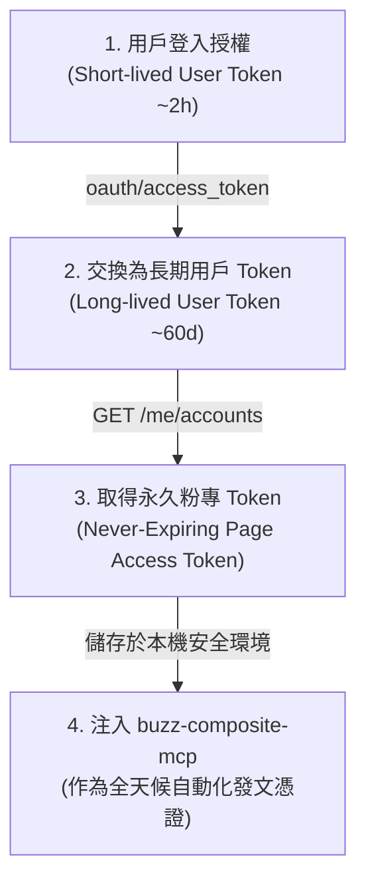
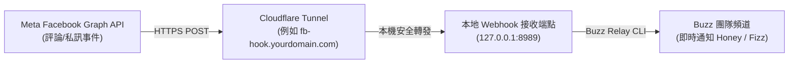

# Facebook API 社交帳號整合與 MCP Tool 自動化管理實作計畫書 (v2.0)

## 一、任務概述

本計畫旨在為 Buzz 平台（Honey, Fizz, Pollen）建立完整的 Facebook Graph API 雙向整合能力，核心目標為：
1. **MCP 原生化 (Native MCP Integration)**：將 Facebook 貼文發佈、留言互動、洞察分析包裝為 6 大標準 MCP 工具，無縫掛載進 `buzz-composite-mcp.exe`，讓 Agent 能在聊天對話中直接下指令管理臉書粉專。
2. **無縫認證 (Never-Expiring Page Token)**：實作由短期 User Token 交換為「永不過期 (Never Expiring) Page Access Token」的標準授權管線，根治 Token 頻繁失效維護難題。
3. **本地 Webhook 即時穿透**：透過 Cloudflare Tunnel / ngrok 安全建立公網 HTTPS 接收端點，即時監聽粉專互動並向 Buzz 頻道推送通知。

---

## 二、核心授權架構：永久 Page Access Token 取得 SOP

在 Meta 官方架構中，一般 User Token 僅 1-2 小時有效，Long-lived User Token 最長 60 天。但只要經過標準兩階段交換，**換取出的 Page Access Token 預設即為「永久有效（Never Expires）」**（除非用戶主動重設密碼或解除應用授權）：



### 具體 API 交換指令：
1. **換取 60 天 User Token**：
   `GET https://graph.facebook.com/v19.0/oauth/access_token?grant_type=fb_exchange_token&client_id={APP_ID}&client_secret={APP_SECRET}&fb_exchange_token={SHORT_USER_TOKEN}`
2. **換取永久 Page Token**：
   `GET https://graph.facebook.com/v19.0/me/accounts?access_token={LONG_USER_TOKEN}`
   * 取得各粉專的 `access_token`，該 Token 即為永久粉專憑證。

---

## 三、Facebook 原生 MCP 工具矩陣 (MCP Tools Specification)

以下 6 大工具將直接註冊於 `C:\私人\tools\buzz-composite-mcp.mjs` 中，透過 stdio 暴露給所有 Buzz Agents：

### 1. `fb_publish_post`（發佈貼文）
* **說明**：發佈純文字貼文、外部連結或設定排程貼文。
* **Input Schema**：
  ```json
  {
    "type": "object",
    "properties": {
      "message": { "type": "string", "description": "貼文內文" },
      "link": { "type": "string", "description": "附帶的外部超連結 (選填)" },
      "scheduled_publish_time": { "type": "integer", "description": "排程發佈之 UNIX 時間戳（選填，需大於當前 10 分鐘）" },
      "published": { "type": "boolean", "description": "是否立即發佈（排程時設為 false）" }
    },
    "required": ["message"]
  }
  ```

### 2. `fb_publish_photo`（發佈圖片貼文）
* **說明**：上傳圖片至粉專相簿或發佈單圖/多圖動態。
* **Input Schema**：
  ```json
  {
    "type": "object",
    "properties": {
      "caption": { "type": "string", "description": "圖片說明文字" },
      "url": { "type": "string", "description": "圖片公開 URL" },
      "published": { "type": "boolean", "description": "是否公開發佈，預設 true" }
    },
    "required": ["url"]
  }
  ```

### 3. `fb_get_recent_posts`（讀取粉專動態）
* **說明**：獲取近期貼文列表與互動統計（按讚數、分享數、留言數）。
* **Input Schema**：
  ```json
  {
    "type": "object",
    "properties": {
      "limit": { "type": "integer", "description": "讀取筆數，預設 5，上限 25" }
    }
  }
  ```

### 4. `fb_get_comments`（讀取貼文留言）
* **說明**：拉取指定貼文下的最新粉絲留言內容。
* **Input Schema**：
  ```json
  {
    "type": "object",
    "properties": {
      "post_id": { "type": "string", "description": "Facebook 貼文 ID" },
      "limit": { "type": "integer", "description": "留言筆數，預設 10" }
    },
    "required": ["post_id"]
  }
  ```

### 5. `fb_reply_comment`（回覆留言）
* **說明**：針對指定留言進行公開回覆或按讚互動。
* **Input Schema**：
  ```json
  {
    "type": "object",
    "properties": {
      "comment_id": { "type": "string", "description": "目標留言 ID" },
      "message": { "type": "string", "description": "回覆內容" }
    },
    "required": ["comment_id", "message"]
  }
  ```

### 6. `fb_get_page_insights`（粉專數據分析）
* **說明**：獲取粉專關鍵營運指標（粉絲成長、曝光觸及 Reach、互動次數）。
* **Input Schema**：
  ```json
  {
    "type": "object",
    "properties": {
      "metrics": {
        "type": "array",
        "items": { "type": "string" },
        "description": "指標名稱，如 page_impressions, page_engaged_users"
      },
      "period": { "type": "string", "enum": ["day", "week", "days_28"], "default": "day" }
    }
  }
  ```

---

## 四、本地 Webhook 即時穿透架構 (Cloudflare Tunnel)

由於 Buzz 運行於本機電腦 (`localhost`)，Meta 伺服器要求 Webhook 回調網址必須為公網且具備合法 HTTPS 憑證：



* **優勢**：免租用公網雲端主機、無需開通路由器 Port Forwarding、內建 SSL 憑證保護。

---

## 五、分階段實施路線圖 (Roadmap)

### 階段一：Meta App 憑證配置與永久 Token 交換
1. 建立 Meta 開發者 App（選擇「企業」或「其他」類型）。
2. 配置權限 Scopes：`pages_show_list`, `pages_manage_posts`, `pages_read_engagement`, `pages_manage_metadata`。
3. 執行換約腳本，取得永久 `FB_PAGE_ACCESS_TOKEN` 與 `FB_PAGE_ID`，加密寫入 `C:\Users\user\.buzz\.env`。

### 階段二：Facebook MCP 工具開發與聚合對接
1. 於 `C:\私人\tools\` 建立 `facebook-mcp-module.mjs`，實作上述 6 大 MCP 工具。
2. 整合至 `buzz-composite-mcp.mjs`，使可用工具庫擴充為 15 項。
3. 測試在 Buzz 聊天室下達指令：*「@Honey 請幫我在粉專發佈今日盤勢重點」*，驗證 Agent 能否自主調用 `fb_publish_post`。

### 階段三：Cloudflare Tunnel 與 Webhook 雙向聯動
1. 配置本地輕量 Webhook 服務器（Node.js，監聽 8989 端口）。
2. 綁定 Cloudflare Tunnel，並至 Meta Developer 後台填入驗證 Token (`hub.verify_token`)。
3. 實作事件轉發：當粉專出現新留言時，自動轉發至 Buzz 頻道，由 Agent 自動構思回覆。

---

## 六、風險評估與防禦措施

1. **Meta App Review 審查門檻**：
   * *應對方案*：前期全面採用「開發者測試模式 (Development Mode)」。在此模式下，App 可免審查直接管理開發者個人名下的所有粉絲專頁，功能 100% 齊全。未來若需對接第三方客戶粉專，再提交公司認證。
2. **API 頻率限制 (Rate Limiting)**：
   * Graph API 限制每小時呼叫上限約 200 次 / Page。
   * *防禦措施*：MCP 工具內建本機記憶體快取（如近期留言快取 60 秒），避免 Agent 連續分析時觸發 429。
3. **安全防護**：
   * Page Access Token 嚴禁進入 Git 版控，全數由本地環境變數隔離管理。
