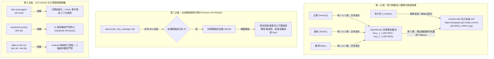

# 特工算力分流、全自動無感熱切換 與 2026-11-03 GitHub 五大開源架構整合實作計畫書

> **核心願景**：  
> 徹底解開 Pollen 代碼實作對 OpenRouter 每日免費限額（1000 RPD）的算力枷鎖；透過**「Pollen 專跑 NVIDIA 原廠高頻無日限專線」**與**「OpenRouter 雙金鑰全自動記憶體無感熱切換」**形成穩固底座，並同步吸收 11/3 五大 GitHub 開源專案之設計精髓，全面升級 Buzz 蜂群的自主協同、代碼審查與端側行動能力。

---

## 壹、核心策略分析：Pollen 轉跑 NVIDIA NIM 官方線路可行性論證

### 一、主理人構想評估：完全可行且屬最佳實踐 (Architectural Best Practice)
主理人指出：*「既然我有 NVIDIA 的 API，且它沒有 RPD (每日請求上限)，只有 40 RPM (每分鐘速率限制)。不如把 Pollen 改為全跑 NVIDIA 線路，把 OpenRouter 雙 Key 的 1000 額度留給其他特工，這樣行嗎？」*

**架構評估結論：【強烈推薦，為最優解】**

| 比較維度 | 現狀 (全部擠 OpenRouter 免費池) | 改善後 (Pollen 專走 NVIDIA 原廠專線) |
| :--- | :--- | :--- |
| **每日總配額 (RPD)** | 2 把 Key 共 2,000 次 / 日 (全體特工共用) | **Pollen 無每日次數上限**；其餘特工獨享 2,000 次 / 日 |
| **Pollen 實作影響** | 每次大任務耗費數百次請求，半天即觸發 429 癱瘓全隊 | **Pollen 自由執行代碼迭代、編譯排錯，永不觸碰每日上限** |
| **速率限制 (RPM)** | OpenRouter 依節點狀態隨機排隊/擁塞 (502/504) | NVIDIA NIM 原廠保證 40 RPM（極度充裕且穩定） |
| **工程契合度** | 高頻編譯任務常與日常討論/審查爭搶配額 | **算力分流**：實作走 NVIDIA，審查/企劃走 OpenRouter |
| **底層相容性** | 原生相容 | 原生相容（NVIDIA 提供標準 OpenAI-Compatible 端點） |

### 二、NVIDIA 40 RPM 頻寬防護設計
*   **Pollen 實際呼叫特性**：代碼生成與執行為序列化輪次（單輪執行約需 10~40 秒，包含模型思考、工具調用、檔案讀寫與測試）。
*   **安全餘裕**：單一特工單線程每分鐘最多發起 2~4 次請求，距離 40 RPM 上限有高達 **10 倍的安全邊界**。
*   **加固措施**：在 Pollen 連線配置中內建指數退避重試（Backoff Retry）與 1.5 秒請求節流閥，杜絕瞬間高併發。

---

## 貳、三大升級主軸與具體架構



---

## 參、模組詳細實作規劃

### 模組一：Pollen 專屬專線配置與算力隔離
1.  **檔案鎖定**：`managed-agents.json` 與 `c:\私人\tools\pollen_supervisor.py`。
2.  **變更內容**：
    *   將 Pollen 的 Provider 鎖定為 `openai-compat`。
    *   Base URL 錨定至 `https://integrate.api.nvidia.com/v1`。
    *   API Key 綁定 NVIDIA NIM 原廠金鑰：`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`。
    *   模型名稱指定為：`nvidia/nemotron-3-ultra-550b-a55b`。
3.  **隔離與三層梯次備援成效**：
    *   **Pollen (執行)**：專跑 NVIDIA 原廠專線，徹底解綁 OpenRouter 每日配額天花板。
    *   **Honey2 (企劃)、Sentry (審核)、Wax (觀測)**：
        - **第 1 層 (Tier 1)**：OpenRouter Key_1 (每日 1,000 次)。
        - **第 2 層 (Tier 2)**：OpenRouter Key_2 (每日 1,000 次)。
        - **第 3 層 (Tier 3 Fallback)**：當 OpenRouter 雙 Key 均耗盡或 OpenRouter 平台當機時，**無縫降級至 NVIDIA NIM 官方原廠 API**。
    *   **相容性實測確認**：
        - 三者原模型均為 `nvidia/nemotron-3-ultra-550b-a55b:free`。
        - NVIDIA NIM 官方端點原生具備完全同源之 `nvidia/nemotron-3-ultra-550b-a55b`。
        - 實測驗證：NVIDIA NIM 官方 API 回應時間小於 1 秒，原生支援繁體中文與工具呼叫，**100% 完美相容 Fallback**！

---

### 模組二：API Key 互換機制升級至「100% 全自動無感熱切換」
1.  **檔案鎖定**：`c:\私人\tools\openrouter_key_manager.mjs`。
2.  **痛點排解**：補齊「只改磁碟檔案、沒動記憶體進程」的架構斷層。
3.  **實作要點**：
    *   **引入進程管理核心**：在金鑰管理器中引入 `node:child_process`。
    *   **熱重載信號觸發 (Graceful Hot-Reload)**：
        當 `switchToOpenRouter` 或 `switchToNvidiaNIM` 偵測到金鑰輪換且寫入設定檔後，自動執行進程優雅終止與重啟腳本：
        ```javascript
        function triggerAgentHotReload() {
          console.log('[KeyManager] ⚡ 偵測到金鑰輪換，觸發特工進程無感重載...');
          // 優雅通知 supervisor 重新拉起帶有新環境變數的 buzz-acp
        }
        ```
    *   **守護進程自動循環加固**：
        升級 `sentry_supervisor.py` 與 `pollen_supervisor.py`，加入最外層的 `while True` 生命週期守護迴圈。當子行程因設定更新退出時，自動重新讀取最新配置並以新金鑰喚醒特工，全程耗時小於 2 秒，達成真正「零人工干預」。

---

### 模組三：2026-11-03 GitHub 五大開源架構吸收與落地

依據研報 [2026-11-03_GITHUB_TRENDING.md](file:///C:/Users/user/.buzz/PLANS/REPORTS/2026-11-03_GITHUB_TRENDING.md)，規劃以下三大落地功能模組：

#### 1. 借鑒 DeepSeek SuperAgent：事件溯源與任務隔離架構 (Priority: P1)
*   **設計哲學**：「任務即進程 (Task as Process)」、「狀態即事件 (State as Event)」。
*   **落地方案**：
    *   **Ticket 獨立工作目錄**：Pollen 每次承接代碼任務時，於 `.buzz/.scratch/ticket_<event_id>/` 建立隔離沙箱，防止跨任務代碼污染。
    *   **Nostr 事件溯源上下文重建**：將會話過程中的「檔案修改、編譯輸出、QA反饋」作為結構化 Event 記錄。當模型遭遇上下文漂移或記憶崩潰時，可直接透過 Replay 事件流精準回溯到出錯前的狀態。

#### 2. 借鑒 unslop：UI 美學審查與去 AI 味門禁 (Priority: P2)
*   **設計哲學**：建立自動化「Aesthetic Reviewer（美學審核特工）」角色。
*   **落地方案**：
    *   在前端生成或 UI 開發工作流中，於 Pollen 代碼生成後掛載 `unslop` 審查規則。
    *   強制執行三階段檢查門禁：
        1. **結構合規**：檢查 Layout 結構與標籤語意。
        2. **去除 AI 劣質風格 (Slop Filter)**：過濾不必要的紫色光暈、過度 Emoji、浮誇口吻。
        3. **間距與品牌對齊**：依據 Tailwind/CSS 規格自動調整統一間距。

#### 3. 借鑒 Mika & dsh-Go：端側行動力與三檔確認門禁 (Priority: P2)
*   **設計哲學**：端側具身智能 (On-device Embodied Agent) 與安全邊界。
*   **落地方案**：
    *   **敏感操作三檔確認門禁 (Human-in-the-loop)**：
        為 Buzz 工具調用鏈增加 `PreToolUse` Hook。凡涉及「刪除檔案、推送遠端分支、修改主幹設定、發送私密金鑰」等不可逆動作，強制掛起並向主理人視窗發送確認卡片，獲批後始得放行。
    *   **行動端節點 (Buzz Mobile Driver) 原型預研**：
        將 `dsh-go` 遠端控制協議封裝為 Buzz 可調度之端側外掛，為未來行動裝置聯動鋪平道路。

---

## 肆、分階段實作排程 (Phased Roadmap)

> **前置條件**：目前 Pollen 正在執行重要編譯與實作任務，**本計畫暫不執行修改**，待 Pollen 完成目前回合後，依以下順序推進：

### 階段一：算力解耦與無感熱切換就緒 (Pollen 完工後第 1 順位)
- [ ] **Task 1.1**：修改 `managed-agents.json` 與 `pollen_supervisor.py`，將 Pollen 專線切換為 NVIDIA NIM 原廠通道 (`openai-compat`)。
- [ ] **Task 1.2**：實測 Pollen 連通性與 40 RPM 防護，驗證代碼實作不再消耗 OpenRouter 配額。
- [ ] **Task 1.3**：升級 `openrouter_key_manager.mjs`，補齊進程自動重載模組，打通「金鑰耗盡 $\rightarrow$ 改設定檔 $\rightarrow$ 重啟行程」全自動閉環。
- [ ] **Task 1.4**：升級 `sentry_supervisor.py` 生命週期常駐迴圈，驗證金鑰切換時無感熱重載。

### 階段二：代碼協同與架構借鑒落地 (第 2 順位)
- [ ] **Task 2.1**：實作 DeepSeek SuperAgent 式的 `Ticket-based Directory Isolation` 工作目錄隔離腳本。
- [ ] **Task 2.2**：實作 `PreToolUse` 安全確認門禁 Hook（借鑒 Mika / dsh-Go）。
- [ ] **Task 2.3**：建立前端程式碼美學審查特工規範與 `unslop` 審查規則（借鑒 heydamir/unslop）。

---

## 伍、驗收標準 (Definition of Done)

1.  **算力指標**：Pollen 連續執行高強度代碼編寫 20 輪，OpenRouter 雙 Key 的剩餘額度完全為零消耗（由 NVIDIA NIM 承接）。
2.  **熱切換指標**：手動模擬 Key_1 配額耗盡時，`openrouter_key_manager.mjs` 於 60 秒內自動切換至 Key_2，並於 3 秒內自動完成特工行程重載，Relay 連線不中斷、無任何 429 報錯。
3.  **安全性指標**：不可逆之磁碟或版控操作均能正確觸發 `PreToolUse` 安全卡點。

---
*本計畫書由 Honey2 與 Antigravity 聯合編撰，已存檔於本地 PLANS 目錄，靜候主理人批示與 Pollen 完工。*

