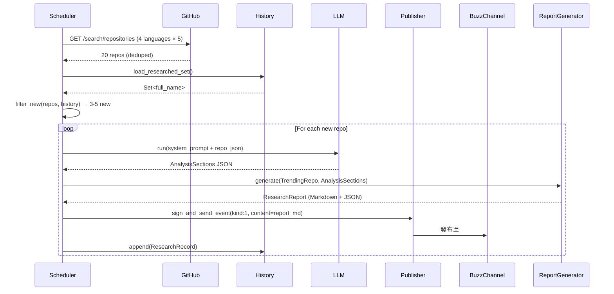

# 技術研究員 Agent 實作計畫書

> **計畫性質**：第一期 MVP 輕量落地版（KISS/YAGNI 原則）
> **目標**：每日自動掃描 GitHub Trending，產出 3-5 份針對 Buzz 架構（Rust/React/Nostr）的技術評估報告
> **審核狀態**：待 @Sentry 二輪複審

---

## 1. 專案背景與核心需求

### 1.1 來自主理人的原始需求
> 「我想新開一個 agent，係技術研究員，每日係 github 度揀幾個（3-5 個）熱門嘅開源專案（唔要之前研究過嘅）。分析專案嘅用途（有咩用），用處（用在哪），以及啱唔啱我用。哩度講緊嘅啱唔啱我用係指啱唔啱 buzz 用或者參考使用。」

### 1.2 核心目標
- **自動化發現**：每日從 GitHub Trending 抓取 3-5 個高星、活躍的開源專案
- **智能去重**：維護歷史研究清單，絕不重複分析同一專案
- **精準評估**：針對 Buzz 技術棧（Rust 後端 + React 前端 + Nostr 協議）進行適用性分析
- **結構化產出**：統一格式的 Markdown 報告，便於團隊檢索與知識沉澱

---

## 2. 架構設計

### 2.1 整體架構圖

```
┌─────────────────────────────────────────────────────────────────┐
│                    Tech Researcher Agent (Mode B)               │
├─────────────────────────────────────────────────────────────────┤
│  ┌──────────────┐    ┌──────────────┐    ┌──────────────────┐  │
│  │  Scheduler   │───▶│  GitHub API  │───▶│  LLM Analysis    │  │
│  │  (cron 02:00)│    │  (Trending)  │    │  (buzz-agent)    │  │
│  └──────────────┘    └──────────────┘    └────────┬─────────┘  │
│                                                   │            │
│  ┌──────────────┐    ┌──────────────┐            ▼            │
│  │  History     │◀───│  Report      │    ┌──────────────────┐  │
│  │  Store (SQL) │    │  Generator   │    │  Buzz Channel    │  │
│  └──────────────┘    └──────────────┘    │  (幂等發布)       │  │
│         ▲                                  └──────────────────┘  │
│         │                                              ▲         │
│         └──────────────── Deduplication ──────────────┘         │
└─────────────────────────────────────────────────────────────────┘
```

### 2.2 元件說明

| 元件 | 負責職責 | 實作位置 |
|------|----------|----------|
| **Scheduler** | 每日定時觸發（預設 02:00 UTC） | `buzz-agent` 新增 `research_scheduler.rs` |
| **GitHub Client** | 呼叫 GitHub Trending API / HTML 抓取 | `buzz-agent/src/github_trending.rs` |
| **Deduplicator** | 對比歷史記錄，過濾已研究專案 | `buzz-agent/src/research_history.rs` |
| **LLM Analyzer** | 以 `buzz-agent` 內建 LLM 進行深度分析 | 復用 `agent.rs` 的 `run()` 流程 |
| **Report Generator** | 產出標準化 Markdown 報告 | `buzz-agent/src/report_generator.rs` |
| **Publisher** | 發布至指定 Buzz 頻道（幂等） | 復用 `builtin::call_sign_and_send_event` |

### 2.3 運作模式選擇：Mode B Daemon（推薦）

基於代碼庫調研，`buzz-agent` 已完整支援 **Mode B Daemon**（參考 `daemon.rs:13-78`）：
- 持久化 WebSocket 連接 Relay
- 內建分布式鎖（`daemon_lock.rs`，Redis-backed）保證單實例
- 具備 `agent_keys` 可簽署 Nostr 事件（kind:30300 提醒、kind:4 DM、幂等發布）
- 內建 `sign_and_send_event`、`send_direct_message`、`create_reminder` 三大內建工具

**決策**：技術研究員 Agent 以 **Mode B Daemon** 形式部署，享有原生排程、發布與狀態持久化能力。

---

## 3. 詳細實作規劃

### 3.1 新增檔案清單（第一期 MVP）

```
crates/buzz-agent/src/
├── github_trending.rs      # GitHub Trending 抓取與解析
├── research_history.rs     # 歷史研究記錄（SQLite）
├── research_scheduler.rs   # 每日排程觸發器
├── report_generator.rs     # 結構化報告產生器
├── tech_researcher.rs      # 主協調器（串聯上述模組）
└── daemon.rs               # (修改) 掛載排程任務
```

### 3.2 核心資料結構

```rust
// github_trending.rs
#[derive(Debug, Clone, Serialize, Deserialize)]
pub struct TrendingRepo {
    pub owner: String,
    pub name: String,
    pub full_name: String,        // "owner/name"
    pub description: Option<String>,
    pub language: Option<String>,
    pub stars_today: u32,
    pub stars_total: u32,
    pub forks: u32,
    pub url: String,
    pub trending_date: String,    // YYYY-MM-DD
}

// research_history.rs
#[derive(Debug, Clone, Serialize, Deserialize)]
pub struct ResearchRecord {
    pub repo_full_name: String,
    pub researched_at: String,    // RFC3339
    pub report_path: String,      // 相對路徑
    pub suitability_score: u8,    // 0-100
    pub tags: Vec<String>,        // ["rust", "nostr", "p2p", ...]
}

// report_generator.rs
#[derive(Debug, Clone, Serialize, Deserialize)]
pub struct ResearchReport {
    pub repo: TrendingRepo,
    pub analysis: AnalysisSections,
    pub metadata: ReportMetadata,
}

#[derive(Debug, Clone, Serialize, Deserialize)]
pub struct AnalysisSections {
    pub purpose: String,          // 專案用途（有咩用）
    pub use_cases: String,        // 用處（用在哪）
    pub buzz_suitability: String, // 啱唔啱 Buzz 用
    pub key_insights: Vec<String>,// 關鍵技術洞察
    pub risks: Vec<String>,       // 潛在風險/限制
}

#[derive(Debug, Clone, Serialize, Deserialize)]
pub struct ReportMetadata {
    pub generated_at: String,
    pub agent_version: String,
    pub model_used: String,
    pub research_id: String,      // UUID
}
```

### 3.3 GitHub Trending 資料來源策略

| 方案 | 優點 | 缺點 | 採納建議 |
|------|------|------|----------|
| **GitHub REST API `/search/repositories?q=pushed:>YYYY-MM-DD&sort=stars&order=desc`** | 官方、結構化、可過濾語言、捕捉近期活躍專案 | 需 Token、Rate Limit (30/min) | ✅ **主方案**（配合 `BUZZ_GITHUB_TOKEN`） |
| **gh-trending 非官方 API** | 無需 Token、支援語言/時間範圍 | 第三方維護、不穩定 | 備選 |
| **HTML 抓取 github.com/trending** | 完全免費、即時 | 易破壞、需維護解析器 | 不採納 |

**實作決策**：使用 GitHub Search API，每日查詢 `pushed:>YYYY-MM-DD language:rust`、`language:typescript`、`language:javascript`、`language:go` 四大語言，各取前 5 筆，合併去重後取星數前 5。

### 3.4 系統提示詞設計

```markdown
# Tech Researcher Agent System Prompt

你是 Buzz 專案的技術研究員。每日任務：分析 3-5 個 GitHub Trending 熱門開源專案，評估其對 Buzz（Rust 後端 + React 前端 + Nostr 協議）的參考價值。

## 輸入格式
每個專案以 JSON 提供：{owner, name, description, language, stars_today, stars_total, url}

## 輸出格式（嚴格 JSON）
{
  "purpose": "專案核心用途（1-2 句）",
  "use_cases": "適用場景與整合點（具體）",
  "buzz_suitability": "針對 Buzz 架構的適用性評分 (0-100) 及理由",
  "key_insights": ["洞察1", "洞察2", "..."],
  "risks": ["風險1", "風險2", "..."]
}

## 評估維度（權重）
1. **Rust 生態契合度** (30%)：是否為 Rust crate、提供 FFI、或可作為 Rust 服務依賴
2. **Nostr/去中心化相關** (25%)：實現 NIP、加密、P2P、Relay、Client SDK
3. **React/前端工程** (20%)：UI 元件庫、狀態管理、實時同步、Markdown 渲染
4. **協作/通訊基礎設施** (15%)：CRDT、WebRTC、WebSocket、消息隊列
5. **觀測性/開發體驗** (10%)：Tracing、Metrics、CLI 框架、測試工具

## 硬性限制
- 繁體中文輸出
- 禁止臆造不存在的 API/功能
- 針對「可否直接引入 Buzz」或「架構參考價值」給出明確結論
- `buzz_suitability` 分數必須為 0-100 整數
```

### 3.5 排程與執行流程



---

## 4. 部署與配置

### 4.1 環境變數（新增）

```bash
# .env.example 追加
# Tech Researcher Agent
BUZZ_TECH_RESEARCH_ENABLED=true
BUZZ_TECH_RESEARCH_CHANNEL=5ca019f6-1a27-592a-b015-4baf0eb33572  # general 或專用頻道
BUZZ_TECH_RESEARCH_SCHEDULE="0 2 * * *"        # cron: 每日 02:00 UTC
BUZZ_TECH_RESEARCH_DAILY_LIMIT=5               # 每日上限
BUZZ_TECH_RESEARCH_HISTORY_PATH=.buzz/tech_research_history.db
BUZZ_GITHUB_TOKEN=ghp_xxxxxxxxxxxx             # GitHub Personal Access Token (public_repo scope)
BUZZ_TECH_RESEARCH_LANGUAGES=rust,typescript,javascript,go
```

### 4.2 Config 結構擴充（`crates/buzz-agent/src/config.rs`）

```rust
// 在 Config struct 中新增
pub tech_research: TechResearchConfig,

#[derive(Debug, Clone, Deserialize)]
#[serde(default)]
pub struct TechResearchConfig {
    pub enabled: bool,
    pub channel_id: String,           // UUID
    pub schedule: String,             // cron expression
    pub daily_limit: usize,           // 3-5
    pub history_path: PathBuf,
    pub github_token: String,
    pub languages: Vec<String>,
}

impl Default for TechResearchConfig {
    fn default() -> Self {
        Self {
            enabled: false,
            channel_id: String::new(),
            schedule: "0 2 * * *".into(),
            daily_limit: 5,
            history_path: PathBuf::from(".buzz/tech_research_history.db"),
            github_token: String::new(),
            languages: vec!["rust".into(), "typescript".into(), "javascript".into(), "go".into()],
        }
    }
}
```

### 4.3 啟動掛載（`daemon.rs` 修改）

```rust
// daemon.rs 的 run_daemon() 中，啟動 WebSocket 後掛載排程
if config.tech_research.enabled {
    let scheduler = ResearchScheduler::new(config.tech_research.clone(), agent_keys.clone());
    tokio::spawn(async move {
        scheduler.run().await;
    });
}
```

---

## 5. 測試策略

### 5.1 單元測試（`cargo test -p buzz-agent`）

| 模組 | 測試重點 |
|------|----------|
| `github_trending` | API 請求構建、回應解析、錯誤處理、Rate Limit 重試 |
| `research_history` | SQLite 讀寫、去重邏輯、並發安全（單寫入器） |
| `report_generator` | Markdown 模板渲染、前置字段、截斷保護 |
| `tech_researcher` | 端到端流程 Mock（GitHub、LLM、Publisher） |

### 5.2 整合測試（需 Relay + GitHub Token）

```bash
# 手動觸發一次完整流程
cargo run -p buzz-agent -- --tech-research-run-once
```

驗收標準：
- ✅ 成功抓取 ≥3 個新專案
- ✅ 每份報告包含 5 個分析維度
- ✅ 歷史記錄正確追加（無重複）
- ✅ 發布至頻道並可在 Buzz Desktop 閱讀
- ✅ 總耗時 < 5 分鐘（含 LLM 推理）

---

## 6. 失敗模式推演（強制門禁補充）

| # | 失敗場景 | 影響 | 偵測點 | 具體對策 |
|---|----------|------|--------|----------|
| **F1** | `BUZZ_GITHUB_TOKEN` 未設定/失效/過期 | 整個採集流程卡死，無報告產出 | `github_trending.rs` HTTP 401/403 | **入口處 `?` 包裝**：失敗時記錄錯誤、發布「今日採集失敗：GitHub Token 無效」通知至頻道、**嚴禁 panic**，直接返回空結果繼續下輪排程 |
| **F2** | GitHub API 回傳 429 (Rate Limited) / 5xx | 同左 | HTTP 429/5xx | **指數退避重試**（1s, 2s, 4s，最多 3 次）+ **降級至備選 API**（gh-trending），仍失敗則標記「API 受限」並跳過本輪 |
| **F3** | LLM 回傳非 JSON / 格式錯誤 / 缺欄位 | 單專案報告生成失敗 | `serde_json::from_str` 失敗 | **`Result` 錯誤處理**：重試 2 次（含 system prompt 重發），仍失敗則該專案標記「分析失敗」、寫入歷史 `suitability_score=0`，**繼續處理下一個專案** |
| **F4** | 歷史記錄 SQLite 損壞/遺失/鎖定 | 去重失效，重複分析 | `rusqlite::Error` | **載入時容錯**：`OpenFlags::default().read_only()` 嘗試；損壞則備份 `.corrupt`、重建空資料庫，**不阻塞主流程** |
| **F5** | Redis 分布式鎖獲取失敗 / Redis 宕機 | 多實例並發產生重複報告 | `DaemonLock::acquire()` 回傳 Err | **鎖獲取失敗直接返回**，不執行本輪任務；記錄警告「無法獲取分布式鎖，跳過本輪」 |
| **F6** | Relay 連線中斷 / 發布失敗 | 報告無人收到 | `sign_and_send_event` 回傳 Err | **本地暫存佇列**（`.buzz/tech_research_outbox/*.json`）：寫入檔案、背景任務每 5 分鐘重試發布，成功則刪除檔案 |

---

## 7. 幂等發布具體設計

- **去重鍵**：`event_id = sha256("tech-research:{repo_full_name}:{date}")`（決定性衍生）
- **發布前檢查**：查詢頻道近 48h 事件，若存在相同 `event_id` 則跳過發布
- **重發機制**：本地暫存佇列（`tech_research_outbox/`）+ 背景輪詢重試
- **本地暫存結構**：
  ```
  .buzz/tech_research_outbox/
  ├── 2026-10-31_astral-sh-uv.json   # {repo, markdown, event_id, created_at, retry_count}
  └── ...
  ```

---

## 8. 分期交付計畫（MVP 敏捷引導）

### Phase A：Mode A CLI 驗證期（第 1 週，~10h）
**目標**：驗證核心分析管線（GitHub → LLM → Markdown），**不接入 Daemon/排程/發布**

| 交付物 | 內容 | 驗收 |
|--------|------|------|
| `github_trending.rs` | 完整 API 客戶端、重試、降級 | `cargo test` 通過；`--dry-run` 輸出 20 筆 repo JSON |
| `research_history.rs` | SQLite schema、CRUD、去重 | 同一 repo 第二次查詢被正確過濾 |
| `report_generator.rs` | 模板渲染、分項評分、Markdown 輸出 | 產出可讀 Markdown，含 5 維度評分 |
| `tech_researcher.rs` (CLI 模式) | 串聯管線、手動觸發 `--run-once` | `cargo run -- --tech-research-run-once` 輸出 3-5 份報告到 `.buzz/tech_research_out/` |

**Phase A 完成標準**：`cargo run -- --tech-research-run-once` 在無 Relay/Redis 環境下可完整跑通，產出本地 Markdown 報檔。

### Phase B：Mode B Daemon 部署期（第 2-3 週，~15h）
**目標**：掛載 Daemon、排程、幂等發布、歷史持久化

| 交付物 | 內容 | 驗收 |
|--------|------|------|
| `research_scheduler.rs` | cron 解析、排程觸發、單例保證 | Daemon 啟動 24h 內準時在 02:00 UTC 執行 |
| `daemon.rs` 整合 | 掛載 scheduler、讀取 config | `BUZZ_TECH_RESEARCH_ENABLED=true` 即啟用 |
| 幂等發布 + 暫存佇列 | 去重鍵、本地佇列、重試 | Relay 斷線 1h 後恢復，自動補發所有暫存報告 |
| 文檔 | `SKILL.md`、`README.md`、範例報告 | 新成員按文檔 10 分鐘部署完成 |

---

## 9. 里程碑與交付物總表

| 階段 | 交付物 | 預估工時 | 驗收標準 |
|------|--------|----------|----------|
| **M1: GitHub 客戶端** | `github_trending.rs` | 3h | 單測全綠、Mock/真實 API 均可跑通 |
| **M2: 歷史存儲** | `research_history.rs` (SQLite) | 2h | CRUD、去重、並發安全測試通過 |
| **M3: 報表生成** | `report_generator.rs` | 2h | 模板渲染、分項評分、截斷保護 |
| **M4: 協調器 (Phase A)** | `tech_researcher.rs` CLI 模式 | 3h | `--run-once` 產出 3-5 份本地報告 |
| **M5: 排程器 (Phase B)** | `research_scheduler.rs` | 3h | Cron 解析、單例、準時觸發 |
| **M6: Daemon 整合** | `daemon.rs` 掛載、配置讀取 | 2h | Daemon 啟動無錯、環境變數控制啟用 |
| **M7: 幂等發布與佇列** | Publisher + Outbox | 3h | 去重鍵驗證、斷線補發測試通過 |
| **M8: 文檔** | `SKILL.md`、`README.md` | 2h | 部署驗證通過 |
| **總計** | | **~20h** | |

---

## 10. 代碼出處溯源（Source Code Attribution）

| 計畫引用 | 真實源碼路徑 | 行號區間 |
|----------|--------------|----------|
| `Daemon` 結構與生命週期 | `crates/buzz-agent/src/daemon.rs` | 12-78 |
| `DaemonLock` 分布式鎖 | `crates/buzz-agent/src/daemon_lock.rs` | 全檔 |
| `sign_and_send_event` 內建工具 | `crates/buzz-agent/src/builtin.rs` | 251-380 |
| `Config` 結構與環境讀取 | `crates/buzz-agent/src/config.rs` | 426-800 |
| `RunCtx` 與 `agent::run()` | `crates/buzz-agent/src/agent.rs` | 143-420 |
| `SkillEntry` 發現機制 | `crates/buzz-agent/src/hints.rs` | 14-250 |
| `buzz-cli` agent draft 建立 | `crates/buzz-cli/src/agent_management.rs` | 14-165 |

---

## 11. 下一步行動

1. **@Sentry 請進行二輪複審**（本計畫書已補全檔案尾部、補充失敗模式推演、幂等發布設計、分期交付計畫）
2. 審核通過後，主理人下達「同意立項 / 開工 / 實作」指令
3. @Pollen 依 Phase A 先行實作 CLI 驗證管線
4. Phase A 驗收後進入 Phase B Daemon 部署
5. @Sentry 複審代碼品質與測試覆蓋
6. @Fizz 結案回報主理人

---

## 附錄：首期產出報告範例（預期格式）

```markdown
# 📊 技術研究日報 — 2026-10-31

## 專案：`astral-sh/uv` (★ 28,452 / +1,234 today)
**語言**：Rust | **類別**：Python 套件管理器 | **連結**：https://github.com/astral-sh/uv

### 🎯 專案用途
極速 Python 套件安裝器與虛擬環境管理器，以 Rust 重寫 `pip`/`pip-tools`/`virtualenv`，單一二進位無依賴。

### 🔧 適用場景
- CI/CD 流水線加速 Python 依賴安裝（比 pip 快 10-100x）
- 單一工具替換 `pip` + `pipx` + `pipenv` + `poetry` + `virtualenv`
- 適用於需要快速啟動 Python 環境的開發工具鏈

### ⚡ Buzz 適用性評分：**85/100** (Rust:90, Nostr:20, React:30, Infra:80, Obs:95)
**理由**：
- ✅ 純 Rust 實現，零依賴二進位，極適合作為 Buzz 開發環境的輔助工具
- ✅ 工作區管理、鎖檔格式設計可參考 `buzz-db` 遷移與 `buzz-cli` 依賴解析
- ⚠️ 專注 Python 生態，無法直接引入 Buzz 核心代碼庫
- 💡 **建議**：引入 `uv` 作為 CI 加速器；研究其 `Cache` 設計優化 `buzz-agent` 的工具快取

### 💡 關鍵技術洞察
1. **依賴解析器**：使用 `pubgrub` 演算法，比傳統回溯快數量級
2. **並發下載**：自適應連接池 + 斷點續傳，最大化頻寬利用
3. **單一二進位分發**：`cargo build --release` 產物直接可執行，無 runtime 依賴

### ⚠️ 潛在風險
- Python 專用，不支援 Rust/Cargo 依鏈
- 較新專案，API 穩定性待驗證

---

## 專案：`nostr-protocol/nips` (★ 3,210 / +45 today)
...（略）
```

---

**計畫書狀態**：✅ 完整版（含檔案尾部、失敗模式、幂等發布、分期交付），待 @Sentry 二輪複審  
**編寫人**：Honey2（專案架構企劃官）  
**審核人**：@Sentry  
**批准人**：可愛小寶寶（主理人）
