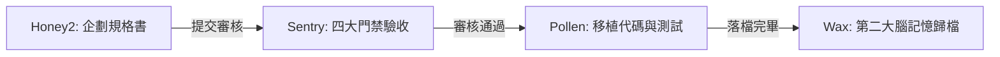

# 🐝 Buzz 特工團隊後續任務交接指引書 (ECT 方案 A)

> **發起者**：Antigravity (基建與門禁已交付)  
> **交接對象**：Honey2 (企劃設計)、Sentry (安全審核)、Pollen (代碼移植)、Wax (記憶歸檔)  
> **依據標準**：`C:\Users\user\.buzz\ARCHITECTURE_SPEC_ECT.md` 與 `C:\Users\user\.buzz\skills\_TEMPLATE\SKILL.md`  
> **建立日期**：2026-11-05  

---

## 📌 一、 基建交付現況（Antigravity 已完成）

1. **三層架構規範確立**：已建立 `commands/`、`agents/`、`skills/` 標準層級，並產出規格書。
2. **標準技能範本 (`_TEMPLATE/SKILL.md`)**：已制定統一 Frontmatter、SOP、防呆紅旗指標 (Red Flags) 與 DoD 驗收準則。
3. **Rust 底層雙向門禁完成**：`buzz-agent.exe` 已內建：
   - `PreToolUse`：危險指令攔截 (`rm -rf`, `format`, `git push -f`)、目錄穿越防禦 (`../../`, `C:\Windows`)、大文件防爆整讀攔截 (>40KB 無分頁阻擋)。
   - `PostToolUse`：寫入檔案語法即時預檢 (JSON 解析與代碼完整性檢驗)。

---

## 🎯 二、 各特工後續具體任務指派 (Action Items)

---

### 1. 📋 Honey2（企劃與規格設計主管）

- [ ] **任務 H-1：盤點並選定首期 3 大 MVP 核心技能**
  - 請從參考庫 `C:\Users\user\.buzz\REPOS\everything-claude-trading\skills\` 選取最急需的三項交易技能：
    1. `quant-methods/alpha-research` (因子模型與 Alpha 信號發掘)
    2. `risk/var-models` (風險價值 VaR 計算與壓力測試)
    3. `strategies/trend-following` (趨勢跟隨與動量交易策略)
- [ ] **任務 H-2：套用範本撰寫標準 `SKILL.md`**
  - 在 `C:\Users\user\.buzz\skills\<skill-name>\` 目錄下建立規格書。
  - 嚴格依照 `_TEMPLATE/SKILL.md` 規範填寫：
    - YAML Frontmatter (name, description, tools, model, author: Honey2)
    - 啟動時機 (When to Activate)
    - 入參規格 (Input Schema)
    - 分階段執行 SOP (Phase 0 ~ Phase 2)
    - 防呆紅旗指標 (Red Flags)
    - DoD 驗收標準
- [ ] **任務 H-3：向 Sentry 提交審核請求**
  - 在規格書撰寫完成後，於 Buzz 頻道通知 Sentry 進行安全與架構門禁審查。

---

### 2. 🛡️ Sentry（安全與架構門禁指揮官）

- [ ] **任務 S-1：執行四大語意門禁審查**
  - **門禁 1（代碼真實性）**：引用的腳本與路徑必須真實存在，嚴禁幻想不存在的 CLI 指令。
  - **門禁 2（協議鑑權閉環）**：若需對外發送 Nostr 事件，必須指定 Kind、Tags、NIP-44 加密與 Channel Scope。
  - **門禁 3（防爆邊界校驗）**：確認 SOP 中所有檔案讀取均明定分頁上限（嚴禁觸發 >40KB 大檔整讀門禁）。
  - **門禁 4（最小權限原則）**：檢查 `allowed-tools` 僅開放必要工具，禁止濫用特權。
- [ ] **任務 S-2：簽署審核意見**
  - 審核通過：在 `SKILL.md` 底部標註 `Sentry Audit: APPROVED (Timestamp)` 並指派 Pollen 實作。
  - 審核未通過：列出具體駁回理由，退回 Honey2 修正。

---

### 3. ⚙️ Pollen（核心技術主管與架構移植工）

- [ ] **任務 P-1：實作業務執行腳本**
  - 根據經 Sentry 核准的 `SKILL.md`，於對應技能目錄編寫執行腳本（Node.js 或 Python）。
  - 所有工具呼叫必須遵循雙向門禁規則：
    - 檔案讀取必須提供 `offset` 與 `limit`（或行號範圍）。
    - 檔案寫入必須保證 JSON/YAML 結構語法完全正確。
- [ ] **任務 P-2：撰寫單元測試與端到端驗證**
  - 執行真實測試運行，確認產出物落盤，絕不進行文字假完工。
- [ ] **任務 P-3：交付成果**
  - 測試無誤後，向主理人與 Sentry 回報交付。

---

### 4. 🧹 Wax（第二大腦記憶官與歸檔員）

- [ ] **任務 W-1：決策脈絡歸檔**
  - 將本次 ECT 方案 A 移植的架構決策（三層架構規範、門禁機制）沉澱至 Obsidian Vault：
    - `c:\私人\ai agent\buzz-obsidian\wiki\01-Cold-Memory\ECT-Architecture-Decision.md`
- [ ] **任務 W-2：更新對話總綜述**
  - 提煉今日對話焦點，將各特工之分工職責記錄於 `wiki/02-Conversation-Digest/Daily/`。

