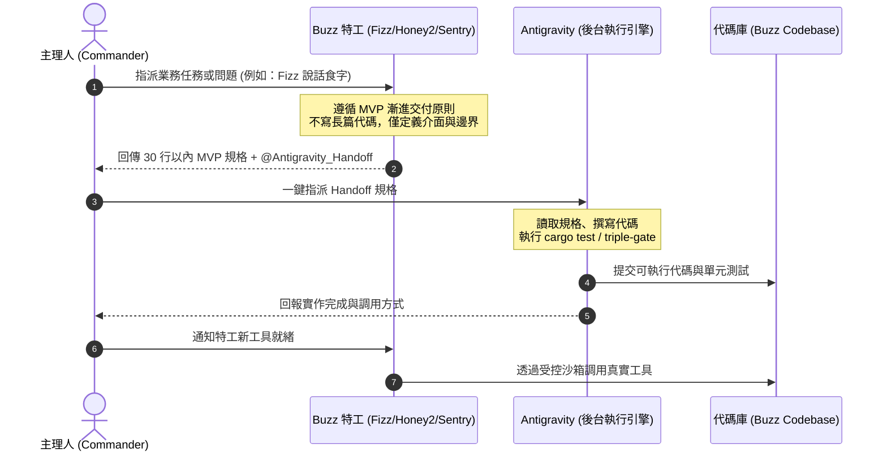

# 特工與 Antigravity 前後台協同標準作業手冊 (SOP)

> **版本**：1.0.0 (Phase 58)  
> **生效日期**：2026-11-21  
> **發布單位**：Buzz 架構委員會  
> **目標讀者**：全體 Buzz 特工、主理人、Antigravity 系統守護者

---

## 1. 緣起與核心痛點

過去特工體系經常發生「特工在聊天室幻想撰寫數百行 Rust/Python 代碼，但因缺乏編譯環境、權限不足或 Token 截斷，導致提案永遠無法變成可執行代碼」的痛點。

為打破「研報套娃」並實現「以可交付代碼為唯一檢驗標準」，特確立前後台明確分工的閉環協同機制。

---

## 2. 雙層分工邊界 (Two-Tier Architecture)



### 職責權利邊界：
| 角色 | 核心職責 | 嚴格禁止事項 |
| :--- | :--- | :--- |
| **特工 (Agent)**<br>Fizz / Honey2 / Sentry / Pollen | 1. 識別業務痛點<br>2. 定義輸入/輸出規格 (JSON/Schema)<br>3. 擬定驗收測試範例<br>4. 輸出標準 `@Antigravity_Handoff` 標籤 | 1. 嚴禁在聊天室假想數百行代碼<br>2. 嚴禁跨回合無限審查挑毛病<br>3. 嚴禁宣稱未實作功能已上線 |
| **主理人 (Commander)** | 1. 業務需求拍板<br>2. 審閱特工之 MVP 規格<br>3. 授權後台 Antigravity 實裝 | 1. 無須親自手寫代碼 |
| **Antigravity (AGY)**<br>後台執行引擎 | 1. 接收 `@Antigravity_Handoff` 規格<br>2. 在後台編寫高質量 Rust / Python 模組<br>3. 執行編譯與全量測試驗證 (`cargo test`, `triple-gate`)<br>4. 納入版控與更新文檔 | 1. 未經主理人確認不得擅自擴大規格範圍 |

---

## 3. 標準移交格式規範 (Handoff Schema)

特工在 Buzz 聊天室輸出規格時，**必須**包含以下固定格式區塊：

````markdown
```antigravity_handoff
[MODULE]: <模組或工具名稱，例如：comm-quality-guard>
[MVP_TARGET]: <本次 MVP 欲解決的具體單一痛點，例如：消除角括號未跳脫與標點吃字>
[INPUT_SPEC]: <輸入字串/JSON 結構範例>
[OUTPUT_SPEC]: <過濾/處理後之輸出範例>
[ACCEPTANCE]: <至少 2 組測試用例及預期結果>
```
````

---

## 4. 異常處理與阻斷升級

1. **若特工再次產出大於 150 行之無代碼計畫書**：主理人直接引用本 SOP 第 2 節，要求其精簡為 30 行以內之 `@Antigravity_Handoff`。
2. **若審核特工 (Sentry) 與企劃特工 (Honey2) 互相打回超過 1 次**：直接視為死結，強制終止對話，改由主理人直接指派 Antigravity 進行後台裁決並落地。
